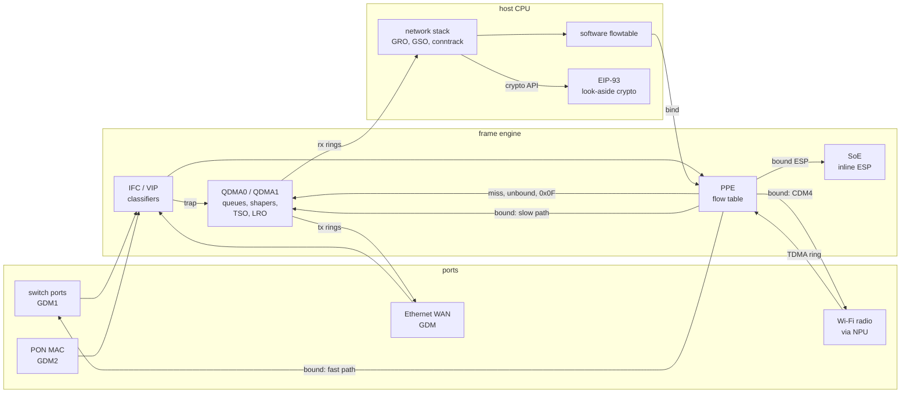
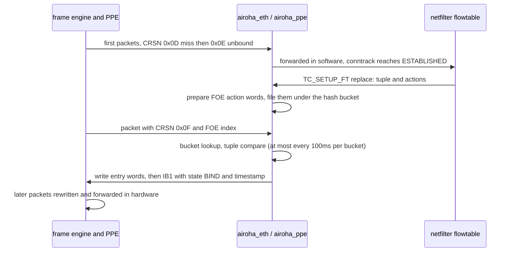
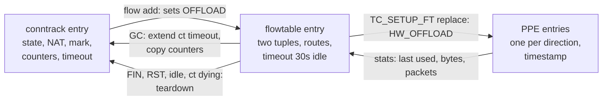
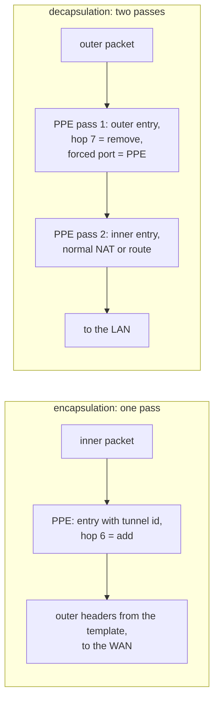
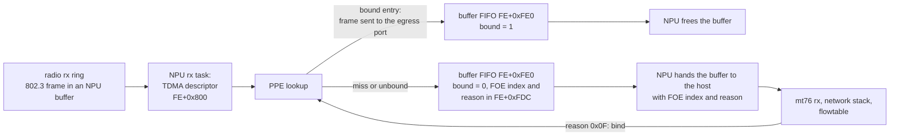
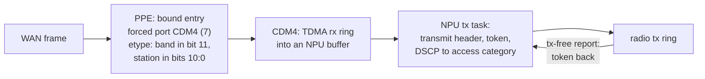
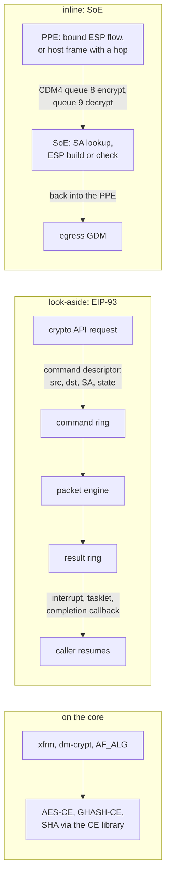

> **Disclaimer.** The behaviour and the performance described here were observed with this project's own
> development software: a mainline-based Linux kernel with custom and in-development drivers, its OpenWrt build,
> and the LibrANPU NPU firmware, on a development unit. Other drivers, firmware or software versions can behave
> and perform differently.

## Contents

1. [Method and test bench](#1-method-and-test-bench)
2. [The paths at a glance](#2-the-paths-at-a-glance)
3. [Host offloads](#3-host-offloads)
4. [Flow offload in the PPE](#4-flow-offload-in-the-ppe)
5. [PPPoE](#5-pppoe)
6. [QDMA as a QoS engine](#6-qdma-as-a-qos-engine)
7. [Classifiers ahead of the PPE](#7-classifiers-ahead-of-the-ppe)
8. [Multicast](#8-multicast)
9. [Tunnels](#9-tunnels)
10. [The PPE in the Wi-Fi datapath](#10-the-ppe-in-the-wi-fi-datapath)
11. [The PPE on the PON uplink](#11-the-ppe-on-the-pon-uplink)
12. [Crypto](#12-crypto)
13. [What each path costs](#13-what-each-path-costs)
14. [Controls and where to look](#14-controls-and-where-to-look)
15. [Open points](#15-open-points)
16. [Appendix A: registers](#appendix-a-registers)

---

## 1. Method and test bench

All measurements come from one test unit running this project's OpenWrt build: a mainline-based 6.18 kernel
and the LibrANPU firmware on the NPU. Every test switches one thing at a time on the same running image, either through
a runtime knob (fw4 options, `ethtool -K`, `tc`, devlink, module load) or, for the crypto drivers, by naming the
implementation explicitly.

| role | equipment |
|---|---|
| unit under test | AN7583: two Cortex-A53 cores at 1.2GHz, switch with four 1G LAN ports, a 2.5G Ethernet LAN port and a 2.5G Ethernet WAN port (both on their own frame-engine MACs), dual-band Wi-Fi 7 radio |
| bench server | Linux host: 1G port on a LAN switch port, 2.5G port on the WAN port (in its own network namespace, acting as the ISP: DHCP, PPPoE, iperf3 and bandwidth-test servers) |
| traffic generator | router with three 1G ports on LAN switch ports and a 2.5G port on the 2.5G LAN port; hardware-paced UDP streams, TCP bandwidth test client |
| Wi-Fi client and monitor | on the bench server: a Wi-Fi 7 USB adapter as the station (5GHz, 160MHz, two spatial streams) and a second adapter as a monitor that records the frames on the air |

The figure of merit for an offload is the host CPU it saves. CPU load is read from `/proc/stat` on the unit over
a window in the middle of each run and given as busy cores (0 to 2). Throughput is TCP goodput from iperf3 or the
bandwidth test, or packets per second from the unit's own port counters. Each point is the median of three to
five runs (each section says how many), with the levels interleaved (A B C, then C B A) so that drift on the bench
does not favour one of them. Ranges in the tables are the minimum and maximum of the runs.

Two limits of the bench come up repeatedly. The bench server's LAN port is 1G, so most TCP tests through the
switch ports reach line rate on every path and differ only in CPU; the 2.5G ports show where each path runs out.
In the small-packet tests the PPE forwarded everything the generator could offer, which was the line rate of its
ports, so the PPE's own limit lies above what could be measured here.

---

## 2. The paths at a glance



*Figure 1. Where a packet can be handled. Everything inside the frame engine runs without the host CPU.*

---

## 3. Host offloads

Every packet the PPE does not carry still crosses the host: the first packets of every connection, everything
that cannot be bound, and all traffic the gateway itself sends or receives (speed tests, file shares, DNS, VPN
endpoints, management). For that traffic the hardware offers the classic NIC offloads, and Linux adds GRO and
GSO in software.

### 3.1 What the hardware does

**Transmit checksum and TSO.** QDMA computes the IPv4 header checksum and the TCP or UDP checksum when the
transmit descriptor asks for it, and segments a TCP frame of up to 64KiB itself; the MSS travels in the TCP
checksum field of the frame. On the AN7583 the request bits sit in message word 0 of the descriptor: bit 12 for
the IPv4 checksum and bit 11 for the L4 checksum. Bit 13 next to them triggers the frame engine's packet
generator and stays clear. The driver offers `NETIF_F_HW_CSUM` and TSO for IPv4 and IPv6, and its
`ndo_features_check` keeps them for frames that carry a DSA tag, up to two VLAN tags or a PPPoE session header
in front of IPv4 or IPv6, with TCP or UDP right after. Anything else, a tunnel or a fragment for example, falls
back to software GSO and a software checksum. Segmentation happens after the QoS queues, so a 64KiB TSO frame is
scheduled as one unit.

**PPPoE.** A PPP device normally has no offloads: its features are SG and FRAGLIST, so every TCP segment sent
over PPPoE was built and checksummed by the CPU. The PPP layer used here lets a single-channel PPPoE session take
the features of the Ethernet device below it, as long as no compression, loopback or multilink is active
(`ppp_features_check`). The frame engine then segments and checksums TCP inside the PPPoE session, and writes the
PPPoE payload length into each segment; the result on the wire was checked byte for byte. `ethtool -k pppoe-wan`
shows it:

```
# ethtool -k pppoe-wan | grep -E '^(tx-checksumming|scatter-gather|tcp-segmentation|generic-seg|generic-rec)'
tx-checksumming: on
scatter-gather: on
tcp-segmentation-offload: on
generic-segmentation-offload: on
generic-receive-offload: on
```

**Receive.** The driver marks every received frame `CHECKSUM_UNNECESSARY`, so the stack never computes a receive
checksum. The hardware gives it no per-frame result to base that on. GLO_CFG at FE+0xE00 sets the PPE to hand
frames with a bad IPv4 or L4 checksum to the host rather than drop them, and no checksum status reaches the
receive descriptor that the driver reads. A frame damaged on the way in would therefore reach a local socket
unchecked. On Ethernet the FCS makes that rare. Hardware LRO exists (eight aggregation contexts on the CDM ports, up to 64
segments in a 16KiB buffer), but it is configured per QDMA and therefore only offered on a device that has its QDMA
to itself. The Ethernet WAN port is not one. Its GDM runs as a LAN-type port on QDMA0, next to the switch's GDM1
and the 2.5G LAN port, because QDMA1 belongs to the PON MAC that this unit also has. So the WAN port refuses LRO:

```
# ethtool -K wan lro on
Could not change any device features
# ethtool -k wan | grep large-receive
large-receive-offload: off [requested on]
```

Without LRO, receive relies on GRO, which merges consecutive segments of a flow in software before the stack
sees them. Linux turns LRO off on devices that forward anyway, because merged frames cannot be forwarded
unchanged; GRO keeps segment boundaries and does not have that problem.

**Interrupts.** Transmit completions are coalesced (`ethtool -C wan tx-usecs 640 tx-frames 32` by default);
receive runs in NAPI with one ring per QDMA in use, so all receive work for a port lands on one core. DMA is not
coherent with the CPU caches on this SoC, so the driver invalidates only the bytes the QDMA wrote into each
receive buffer, not the whole buffer.

### 3.2 Measured

The test ran TCP between the bench server and the unit's own address on the 2.5G WAN port, switching each
offload off at run time with `ethtool -K wan`, five runs per point:

| traffic the unit terminates | offloads | Mbps | busy cores | cores per Gbps |
|---|---|---|---|---|
| receive, 1 connection | all on | 1,766 (1,733-1,791) | 1.72 | 0.97 |
| receive, 1 connection | GRO off | 970 (964-973) | 1.71 | 1.76 |
| receive, 4 connections | all on | 1,723 (1,697-1,849) | 1.63 | 0.95 |
| receive, 4 connections | GRO off | 880 (873-886) | 1.72 | 1.95 |
| send, 4 connections | all on | 2,349 (2,335-2,354) | 0.85 | 0.36 |
| send, 4 connections | TSO off | 1,925 (1,872-1,980) | 1.29 | 0.67 |
| send, 4 connections | TX checksum off | 1,559 (1,518-1,850) | 1.25 | 0.80 |
| send, 1 connection | all on | 1,053 (822-1,421) | 0.48 | 0.46 |


*Figure 2. CPU per Gbps for TCP the unit terminates on its 2.5G WAN port, with and without each offload.*

Receiving is the expensive direction. With GRO the unit takes 1.7-1.8Gbps and both cores are nearly full;
without it the rate halves at the same CPU, because every 1,500-byte segment then walks the stack on its own.
Sending is cheap with TSO and the checksum offload: four connections fill the 2.5G link at 0.85 cores. Turning
TSO off costs about twice the CPU per bit, and turning the checksum offload off costs more, because it also
disables TSO and scatter-gather (`ethtool` drops features that depend on it). A single sending connection varies
from run to run (822 to 1,421Mbps) with the receiver's window, not with the unit's CPU, which stays near half a
core.

---

## 4. Flow offload in the PPE

### 4.1 From conntrack to a hardware entry

Linux decides what is offloaded. The PPE only carries out that decision. An nftables flowtable with the
`offload` flag (fw4 writes one when `flow_offloading_hw` is set) hands each established connection to the
driver through `TC_SETUP_FT`. The driver turns the flowtable's match and actions (addresses, ports, MAC rewrite,
VLAN and PPPoE push, output device) into the action words of a FOE entry. It does not write the entry yet. It
computes the hash the hardware will use for that tuple and keeps the prepared entry in a software list for
that hash bucket.

The hardware creates the entry on its own. The first packet of every tuple misses the table, and the PPE
allocates an unbound entry in one of the two slots its hash functions point at. It then counts the flow's
packets. Once a flow passes the bind rate (BNDR, 30 packets per second on this configuration), the next packet
reaches the host with CPU reason 0x0F, "hit an unbound entry, bind rate reached", and the FOE index in the
receive descriptor. Only then does the driver look in that bucket for a prepared entry with the same tuple. If
it finds one it copies the action words into the slot and sets the state to bound.



*Figure 3. From the first packet to a bound entry.*

The order has two consequences. A flow bound in the PPE always exists in the flowtable first, so every offload
policy (zones, marks, `flow add` rules) applies unchanged. And a flow that never reaches the bind rate stays on
the CPU even when the flowtable holds it: a UDP stream at 20 packets per second is forwarded by the software
flowtable for its whole life. The driver also checks a bucket at most once every 100ms, so a burst of
reason-0x0F packets costs one lookup.

The hash the driver computes is the one the hardware uses for hash mode 0. For an IPv4 tuple the three input
words are the port pair, the destination address and the source address:

```
h = (hv1 & hv2) | (~hv1 & hv3)
h = rotate_left(h, 8)
h = h ^ hv1 ^ hv2 ^ hv3
h = (h ^ (h >> 16)) & (entries - 1)
```

IPv6 tuples fold the 128-bit addresses and the ports into the same three words. The second hash function
(mode 1) gives each flow a second candidate slot, so the table fills well past what a single hash would allow
before flows are refused.

### 4.2 What an entry carries

A bound entry is 80 bytes: the tuple it matches, the rewrite, and three words that tell the frame engine where
the packet goes next. Two entries from the unit's debug dump, for one TCP connection from a LAN host to a
server behind the NAT (addresses replaced by example values; lines wrapped):

```
# cat /sys/kernel/debug/ppe/bind
00a8 BND IPv4 5T orig=192.168.1.133:38591->10.99.0.1:5201 new=10.99.0.122:38591->10.99.0.1:5201
     eth=02:00:00:00:00:02->02:00:00:00:00:01 etype=0800 data=007f6000 ib1=21000108 ib2=0003e660
0a94 BND IPv4 5T orig=10.99.0.1:5201->10.99.0.122:38591 new=10.99.0.1:5201->192.168.1.133:38591
     eth=02:00:00:00:00:03->02:00:00:00:00:04 etype=8002 data=007f0800 ib1=21000108 ib2=0003e621
```

| field | upload entry | download entry | meaning |
|---|---|---|---|
| IB1 29:28 state | 2 | 2 | bound |
| IB1 27:25 type | 0 | 0 | IPv4 NAPT (5-tuple, address and port rewrite) |
| IB1 24 | 1 | 1 | decrement the TTL |
| IB1 14:0 | 0x108 | 0x108 | bind timestamp, refreshed by every hit |
| IB2 8:5 forced port | 3 | 1 | PSE port: GDM3 (the Ethernet WAN) or GDM1 (the switch) |
| IB2 9 PSE_QOS | 1 | 1 | the packet goes through a QDMA hardware-forward queue (channel and queue in DATA), where shapers and schedulers apply |
| IB2 10 FAST | 1 | 1 | that queue's descriptors come from on-chip SRAM instead of DRAM |
| IB2 4:0 NBQ | 0 | 1 | queue within the egress port |
| IB2 31:24 DSCP | 0 | 0 | DSCP written into every forwarded packet (§6.3) |
| DATA 15:11 channel | 12 | 1 | QDMA QoS channel: one per egress device, one per switch user port |
| DATA 10:8 queue | 0 | 0 | queue in that channel, from the flow's priority or its DSCP |
| DATA 23:16 | 0x7F | 0x7F | no meter |
| L2 `etype` | 0x0800 | 0x8002 | on a switch port: special tag with the port bitmap (bit 1 = the first LAN port); on a plain GDM: the ethertype |

The `etype` field changes meaning with the egress port. Towards the switch it is the special tag that selects
the user port. Towards a Wi-Fi station it holds the radio band in bit 11 and the station index in bits 10:0.
Towards the PON MAC it is the GEM port.

Entry types the driver writes:

| type | used for |
|---|---|
| IPv4 NAPT | NAT with ports: TCP, UDP |
| IPv4 route (3-tuple) | flows without L4 ports, for example GRE between a LAN host and a WAN peer |
| IPv6 5-tuple / 3-tuple | routed IPv6, with and without ports |
| L2 bridge, with IP subflows | bridged flows; each IP flow inside a bridged MAC pair gets its own subflow entry, so PPPoE sessions and VLAN tags survive |

Hardware learning is limited to the routed IPv4 and IPv6 types (FLOW_CFG at FE+0xE04). L2 bridge learning,
tunnel keys, DS-Lite, 6RD and fragments are off, and the IP protocol list (FE+0xE08 to FE+0xE0C) keeps IPv6-in-IPv4
and IPIP out of 5-tuple learning. Everything in that list stays with the host, which forwards it in software
or through the software flowtable.

### 4.3 How Linux tracks an offloaded connection

Three tables describe one offloaded connection, and they stay in step through the flowtable's garbage
collector.



*Figure 4. The three records of an offloaded connection and what moves between them.*

**conntrack** keeps the connection itself: the two tuples, the NAT mapping, the TCP state, the mark, the
counters. It is the only one of the three that exists before the first packet is forwarded, and it is what
`conntrack -L` shows.

**The flowtable** is the software fast path and, with the `offload` flag, the source of hardware entries. fw4
puts one rule at the top of the forward chain:

```
chain forward {
    type filter hook forward priority filter; policy drop;
    meta l4proto { tcp, udp } flow add @ft
    ct state vmap { established : accept, related : accept }
    ...
}
```

`flow add` is evaluated for every TCP and UDP packet, but it only creates an entry when the connection is
ready. A TCP packet must not carry FIN or RST, and the connection must be established. UDP qualifies as soon as
conntrack has confirmed the entry, which happens on its second packet even if nothing ever came back. A
connection with a helper, a sequence adjustment or a NAT clash never qualifies. For a connection that passes,
the kernel looks up the route for both directions, including the L2 next hop, sets the `OFFLOAD` status bit on
the conntrack entry and adds the flowtable entry. From then on, packets of that connection that reach the CPU take
the flowtable's ingress hook and skip the forward chain, routing and conntrack.

With `flags offload` the flowtable also asks the driver for hardware entries. The driver accepts or refuses per
connection, and conntrack shows the result as a second flag: `[OFFLOAD]` means the software flowtable carries
the connection, `[HW_OFFLOAD]` means the PPE does.

**Keeping them alive.** A packet the PPE forwards never reaches conntrack, so conntrack's own timeout would
expire a busy connection. The flowtable's garbage collector runs every second; for each hardware entry it asks
the driver for statistics. The driver reports the time since the PPE last hit the entry (from the entry's
15-bit timestamp) and, with QDMA accounting, the bytes and packets. The collector moves the flowtable timeout
forward by that "last used" time, extends the conntrack timeout, and adds the counters to the conntrack entry.
A flowtable entry dies after 30 seconds without traffic (`net.netfilter.nf_flowtable_tcp_timeout` and
`nf_flowtable_udp_timeout`); conntrack then takes the connection back with its normal timeouts.

**Ending.** The PPE never binds TCP packets with SYN, FIN or RST (CPU reason 0x0C), so a FIN reaches the host
even on a bound connection. The flowtable sees it and tears the entry down; the driver deletes both PPE entries,
and the connection finishes in conntrack as any other. The same teardown runs when conntrack drops the entry
(`conntrack -D`, a flush, a timeout) or when a route or neighbour the entry used goes away.

**What it looks like.** The following is one TCP upload from a LAN host through the NAT, read on the unit while
it ran. With `flow_offloading=1` and `flow_offloading_hw=0` the software flowtable carries it, and the flowtable is
attached to the bridge and the WAN device:

```
# conntrack -L -p tcp --dport 5201
tcp  6 src=192.168.1.133 dst=10.99.0.1 sport=50787 dport=5201 packets=473436 bytes=1512418445
       src=10.99.0.1 dst=10.99.0.122 sport=5201 dport=50787 packets=91164 bytes=4743920 [OFFLOAD] mark=0 use=2
# nft list flowtable inet fw4 ft
table inet fw4 {
	flowtable ft {
		hook ingress priority filter
		devices = { "br-lan", "wan" }
		counter
	}
}
```

With `flow_offloading_hw=1` fw4 attaches the flowtable to the ports below the bridge instead, because the PPE
needs to know the real egress port, and adds `flags offload`. The connection carries `[HW_OFFLOAD]`, its counters
keep growing although no packet reaches the host (the QDMA counts the packets of each bound flow), and the
PPE entry's timestamp in IB1 moves forward with every hit:

```
# conntrack -L -p tcp --dport 5201
tcp  6 src=192.168.1.133 dst=10.99.0.1 sport=47071 dport=5201 packets=1084684 bytes=1668252041
       src=10.99.0.1 dst=10.99.0.122 sport=5201 dport=47071 packets=30130 bytes=2711222 [HW_OFFLOAD] mark=0 use=2
# nft list flowtable inet fw4 ft
table inet fw4 {
	flowtable ft {
		hook ingress priority filter
		devices = { "lan0", "lan1", "lan2", "lan3", "lan4", "wan" }
		flags offload
		counter
	}
}
# grep ':5201 ' /sys/kernel/debug/ppe/bind
012bc BND IPv4 5T orig=192.168.1.133:47071->10.99.0.1:5201 new=10.99.0.122:47071->10.99.0.1:5201
      eth=02:00:00:00:00:02->02:00:00:00:00:01 etype=0800 data=007f6000 vlan=0,0 ib1=21000ec3 ib2=0003e660
```

The conntrack line has no timeout while the flowtable owns the connection. Two seconds after the transfer
ended with FIN the connection is back to `[OFFLOAD]`: the hardware entries are gone and the software entry is
being torn down. Half a minute later conntrack has it as an ordinary closing connection:

```
# conntrack -L -p tcp --dport 5201
tcp  6 1 CLOSE src=192.168.1.133 dst=10.99.0.1 sport=47071 dport=5201 packets=2351256 bytes=3616214441
       src=10.99.0.1 dst=10.99.0.122 sport=5201 dport=47071 packets=65496 bytes=5894688 [ASSURED] mark=0 use=1
```

A UDP flow that stops shows the idle timeout. It stays `[HW_OFFLOAD]` for about 30 seconds after its last
packet, then leaves the flowtable and conntrack takes over with its own UDP timeout, counting down from 180
seconds:

```
# conntrack -L -p udp --dport 5201        (20 s after the last packet)
udp  17 src=192.168.1.133 dst=10.99.0.1 sport=34022 dport=5201 packets=1002 bytes=565458
        src=10.99.0.1 dst=10.99.0.122 sport=5201 dport=34022 packets=1 bytes=32 [HW_OFFLOAD] mark=0 use=2
# conntrack -L -p udp --dport 5201        (35 s after the last packet)
udp  17 143 src=192.168.1.133 dst=10.99.0.1 sport=34022 dport=5201 packets=1002 bytes=565458
        src=10.99.0.1 dst=10.99.0.122 sport=5201 dport=34022 packets=1 bytes=32 mark=0 use=1
```

**Holding a connection back.** Some setups want to see more than the first packets of a connection before it
disappears into hardware: traffic classifiers, accounting per application, debugging. The fw4 used here has
three options that only shape the `flow add` rule:

| UCI option (`firewall.@defaults[0]`) | rule it produces | effect |
|---|---|---|
| `flow_offloading_delay N` | `ct packets >= N flow add @ft` | offload once the connection carried N packets, both directions counted |
| `flow_offloading_mark MARK/MASK` | `ct mark and MASK == MARK flow add @ft` before the delayed rule | a classifier marks a connection to offload it at once |
| `flow_offloading_skip_mark MARK/MASK` | `ct mark and MASK != MARK` in front of both rules | a marked connection is never offloaded |

The delay counts both directions. A download sends few packets back: a phone's video stream carried about
2,200 packets up for 83,000 down, so a count of one direction would hold such a connection on the CPU for its
whole life.

The three options together, as fw4 writes them, with a small table that marks test traffic by port:

```
# uci set firewall.@defaults[0].flow_offloading_delay=1000
# uci set firewall.@defaults[0].flow_offloading_mark=0x80000000/0x80000000
# uci set firewall.@defaults[0].flow_offloading_skip_mark=0x40000000/0x40000000
# uci commit firewall; fw4 reload
# nft list chain inet fw4 forward | grep 'flow add'
meta l4proto { tcp, udp } ct mark & 0x40000000 != 0x40000000 ct mark & 0x80000000 == 0x80000000 flow add @ft comment "!fw4: Offload marked flows at once"
meta l4proto { tcp, udp } ct mark & 0x40000000 != 0x40000000 ct packets >= 1000 flow add @ft
# nft list chain inet accel mark_conn
table inet accel {
	chain mark_conn {
		type filter hook forward priority filter - 10; policy accept;
		tcp dport 5201 ct mark set ct mark | 0x40000000
		tcp dport 5202 ct mark set ct mark | 0x80000000
	}
}
```

The marking chain runs before fw4's forward chain (priority filter - 10), so the mark is set by the time `flow
add` is evaluated. What the connections then do, read during a transfer:

```
# conntrack -L -p tcp --dport 5202       (marked for offload at once, 0.6 s into the transfer)
tcp  6 src=192.168.1.133 dst=10.99.0.1 sport=35621 dport=5202 packets=20 bytes=44525
       src=10.99.0.1 dst=10.99.0.122 sport=5202 dport=35621 packets=31 bytes=1632 [HW_OFFLOAD] mark=2147483648 use=2
# conntrack -L -p tcp --dport 5203       (not marked: offloaded after 1,000 packets, 0.6 s in)
tcp  6 7438 ESTABLISHED src=192.168.1.133 dst=10.99.0.1 sport=33725 dport=5203 packets=8 bytes=589
       src=10.99.0.1 dst=10.99.0.122 sport=5203 dport=33725 packets=7 bytes=376 [ASSURED] mark=0 use=1
tcp  6 src=192.168.1.133 dst=10.99.0.1 sport=45275 dport=5203 packets=1750 bytes=8224461
       src=10.99.0.1 dst=10.99.0.122 sport=5203 dport=45275 packets=186 bytes=9968 [HW_OFFLOAD] mark=0 use=2
# conntrack -L -p tcp --dport 5201       (marked to skip, 7 s in)
tcp  6 300 ESTABLISHED src=192.168.1.133 dst=10.99.0.1 sport=38831 dport=5201 packets=29384 bytes=152799125
       src=10.99.0.1 dst=10.99.0.122 sport=5201 dport=38831 packets=10635 bytes=561764 [ASSURED] mark=1073741824 use=1
```

The marked connection is in hardware after 51 packets. On the unmarked port the bulk connection crossed the
1,000-packet hold within the first 0.6 seconds, while the test tool's control connection, 15 packets in total,
stays in software for its whole life. Keeping such short connections on the CPU is what the hold is for. The
skipped connections never leave the CPU: four of them carried 713Mbps at 1.36 cores, against 941Mbps at 0.04
cores for an offloaded transfer.


### 4.4 What the PPE saves

The same TCP traffic was forwarded through the NAT three ways: plain forwarding (no flowtable), the software
flowtable (`flow_offloading=1`) and the PPE (`flow_offloading_hw=1`). The software flowtable skips the routing
lookup, the netfilter hooks and most of conntrack for established flows, but every packet still crosses the
driver, the DMA rings and the softirq.

Between the two 2.5G ports, where nothing else limits the rate:

| path | LAN to WAN | WAN to LAN | busy cores | cores per Gbps |
|---|---|---|---|---|
| plain forwarding | 1619Mbps (1550-1626) | 1038Mbps (556-1311) | 1.39 / 1.33 | 0.86 / 1.29 |
| software flowtable | 2226Mbps (1558-2241) | 1978Mbps (1437-1990) | 1.51 / 1.48 | 0.68 / 0.75 |
| PPE | 2476Mbps (2471-2477) | 2478Mbps (2476-2479) | 0.005 / 0.005 | 0.002 |


*Figure 5a. TCP throughput through the NAT between the 2.5G ports. Rates are frame bytes at the egress port.*


*Figure 5b. Host CPU for the same runs.*

Between a 1G switch port and the 2.5G WAN port every path reaches the 1G line rate with four connections, and
the difference is only CPU: 1.33 cores per Gbps for plain forwarding, 1.32 for the software flowtable, 0.003 for
the PPE.

| path, 1G LAN to 2.5G WAN | 1 connection | 4 connections | 4 connections, WAN to LAN |
|---|---|---|---|
| plain forwarding | 801Mbps, 1.24 cores | 933Mbps, 1.24 cores | 939Mbps, 1.22 cores |
| software flowtable | 932Mbps, 1.23 cores | 941Mbps, 1.24 cores | 941Mbps, 1.03 cores |
| PPE | 909Mbps, 0.001 cores | 941Mbps, 0.003 cores | 941Mbps, 0.002 cores |

The software paths never use both cores fully. They stop near 1.25 cores at 1G and near 1.5 cores at 2.5G,
because each QDMA has one receive ring in use and its NAPI context runs on one core; the second core only picks up
transmit completions and housekeeping unrelated to the transfer. The software flowtable is cheaper per bit at 2.5G
than at 1G, 0.68 against 1.32 cores per Gbps, because packets arrive in larger batches per interrupt and the
per-poll cost is spread over more of them. The PPE runs both directions at line rate with the CPU idle; the only
host work left is the first packets of each connection.

The single-connection runs vary more than the others, 463 to 933Mbps on plain forwarding, because one TCP flow
follows the host's scheduling noise directly. The 16-connection runs were dropped from the table because the
sending host dominated them too. Its TCP produced 7,000 to 20,000 retransmissions per run on every path, while
the counters at the sender, the unit's ingress and egress and the receiver matched within 0.01%, so the unit
lost nothing.

### 4.5 Small packets

Large frames hide per-packet cost. With 64-byte frames the generator offered 3.0Mpps through three 1G switch
ports, or 3.7Mpps (the 2.5G line rate) through the 2.5G LAN port, as one-way UDP flows to a host behind the NAT.
In the other direction the bench server sent 2.69Mpps into the WAN port, spread by port forwards over four hosts
on the LAN ports. The unit's own port counters gave what got through:

| path | LAN to WAN, 3 x 1G ports, 1,500 flows | LAN to WAN, 2.5G port, 500 flows | WAN to LAN, 4,000 flows |
|---|---|---|---|
| plain forwarding | 40kpps (34-45), 1.38 cores | 50kpps (50-51), 1.13 cores | 57kpps (57-57), 1.16 cores |
| software flowtable | 92kpps (92-92), 1.26 cores | 111kpps (111-111), 1.31 cores | 146kpps (145-146), 1.39 cores |
| PPE | 3,075kpps (3,014-3,114), 0.024 cores | 3,725kpps (3,725-3,726), 0.010 cores | 2,690kpps (2,689-2,692), 0.060 cores |


*Figure 6. 64-byte frames through the NAT in both directions, median of 4 or 5 runs. Note the log scale.*

On the software paths every frame reaches the host: the receive counters show the full offered rate. The core
then spends its time taking frames off the ring and dropping most of them, and forwards 1 to 5 percent of them,
the classic receive livelock. The PPE forwards whatever arrives, in both directions: 64-byte frames at the 2.5G
line rate, at one or two hundredths of a core.

The same holds for every frame size from the three 1G ports into the 2.5G WAN port:

| frame | offered | forwarded by the PPE | host CPU |
|---|---|---|---|
| 64B | 3,121kpps | 3,121kpps | 0.024 cores |
| 128B | 2,136kpps | 2,135kpps | 0.025 cores |
| 256B | 1,142kpps | 1,141kpps | 0.026 cores |
| 512B | 591kpps | 591kpps | 0.025 cores |
| 1024B | 301kpps | 301kpps | 0.024 cores |
| 1518B | 204kpps | 204kpps | 0.024 cores |

From 128 bytes up the offered rate is the 2.5G line rate of the WAN port.

These runs held a measurement trap. The WAN link negotiates Ethernet flow control, and a receiver that cannot
keep up sends PAUSE frames; here that was the bench server, at about 545,000 packets per second. The unit obeys
them, the frame engine stops taking frames from the PPE, and the back-pressure reaches the LAN ports, whose
switch then drops at ingress. The result looks exactly like a forwarding limit of the unit. Only the receiving
NIC's counters give it away: `ethtool -S` on the receiver showed tens of thousands of transmitted PAUSE frames
per run. All numbers above were taken with flow control off on the receiver (`ethtool -A <dev> rx off tx off`).

One-way flows also exposed a binding condition. A flow binds in hardware only when the unit has a neighbour
entry for its source. The flowtable needs the L2 next hop of both directions for a hardware entry, and a host
that never answers ARP leaves the reply direction unresolved, so the flow stays in the software flowtable, on
the CPU, for its whole life.

### 4.6 Many flows

The PPE forwards a bound flow without the host, but the host still keeps every flow alive. Once a second the
flowtable's garbage collector asks the driver for each hardware flow's statistics, and the driver reads both
PPE entries of the flow through the SRAM access window (RAM_CTRL at FE+0xF1C, then 20 data words from RAM_DATA)
to get its timestamp. That cost grows with the number of flows, not with the traffic:

| flows bound | 0 | 300 | 1,000 | 3,000 | 6,000 |
|---|---|---|---|---|---|
| host CPU, busy cores | 0.003 | 0.003 | 0.014 | 0.031 | 0.075 |


*Figure 7. Host CPU while the PPE carries a number of slow flows (about 100 packets per second each).*

At about 0.012 cores per 1,000 flows it stays small next to the cost of forwarding in software. Held for five
minutes, 3,000 bound flows stayed bound both at a low rate and under a full-rate flood.

---

## 5. PPPoE

Many access networks still hand out their service over PPPoE: every packet on the WAN side carries an 8-byte
PPPoE session header and a 2-byte PPP protocol field between the Ethernet header and IP. PPPoE costs a software
gateway twice. It adds per-packet work (headers to add and remove, a lookup of the session), and it hides the IP
packet behind an extra header, so offloads that expect IP right after Ethernet stop working. The tests below ran
over a PPPoE session between the unit's 2.5G WAN port and a PPPoE server in kernel mode on the bench server, with
the usual 1,492-byte MTU.

### 5.1 The session, as Linux sees it

pppd creates `pppoe-wan`, a PPP device on top of the Ethernet `wan`. The session id and the server's MAC sit in
the kernel's PPPoE socket table, and fw4 puts both devices in the WAN zone and clamps the TCP MSS of forwarded
connections to the route MTU in both directions:

```
# cat /proc/net/pppoe
Id       Address              Device
00000100 02:00:00:00:00:01      wan
# ip link show pppoe-wan | head -1
22: pppoe-wan: <POINTOPOINT,MULTICAST,NOARP,UP,LOWER_UP> mtu 1492 qdisc noqueue state UNKNOWN mode DEFAULT group default qlen 3
# nft list ruleset | grep maxseg
oifname { "wan", "pppoe-wan" } tcp flags & (fin | syn | rst) == syn tcp option maxseg size set rt mtu comment "!fw4: Zone wan IPv4/IPv6 egress MTU fixing"
iifname { "wan", "pppoe-wan" } tcp flags & (fin | syn | rst) == syn tcp option maxseg size set rt mtu comment "!fw4: Zone wan IPv4/IPv6 ingress MTU fixing"
```

### 5.2 The unit as a PPPoE endpoint

For traffic the unit sends itself, the offloads of section 3 carry through the session: `pppoe-wan` inherits TSO
and the checksum offload from `wan`, and the frame engine segments TCP inside the PPPoE header and fixes the PPPoE
length of every segment. On receive, GRO runs on the Ethernet device, before the PPPoE header comes off; the
kernel's PPPoE GRO handler merges segments of the same session and flow there. The GRO flag of `pppoe-wan` itself
has no effect; the one on `wan` does:

| traffic over PPPoE the unit terminates, 4 connections | Mbps | busy cores | cores per Gbps |
|---|---|---|---|
| send, TSO + checksum inside PPPoE | 1,667 (1,323-2,170) | 0.92 | 0.55 |
| send, TSO off (`ethtool -K pppoe-wan tso off`) | 1,331 (1,284-1,476) | 1.46 | 1.10 |
| send, TX checksum off | 1,162 (1,048-1,179) | 1.41 | 1.21 |
| receive, all on | 1,641 (1,620-1,870) | 1.59 | 0.97 |
| receive, `ethtool -K pppoe-wan gro off` | 1,692 (1,645-1,794) | 1.65 | 0.97 |
| receive, `ethtool -K wan gro off` | 678 (676-679) | 1.67 | 2.46 |

Sending over PPPoE costs half as much CPU per bit with the hardware segmenting inside the session as without.
Receiving costs the same as on plain Ethernet as long as GRO on the Ethernet device is on, and two and a half
times as much without it.

### 5.3 PPPoE flows in the PPE

A forwarded connection over PPPoE binds like any other, with three differences in the entry. IB1 bit 22 tells the
PPE to push a PPPoE session header on the way out; the L2 word carries the session id; and `etype` is 0x8864, the
PPPoE session ethertype, so the frame leaves as a PPPoE frame. On the way in, the PPE parses through the PPPoE
header to the IP tuple and removes it. Read during an upload through the NAT:

```
# conntrack -L -p tcp --dport 5201
tcp  6 src=192.168.1.133 dst=10.99.0.1 sport=34667 dport=5201 packets=82006 bytes=126129745
       src=10.99.0.1 dst=10.99.0.100 sport=5201 dport=34667 packets=13311 bytes=1210542 [HW_OFFLOAD] mark=0 use=2
# grep ':5201 ' /sys/kernel/debug/ppe/bind
00bb4 BND IPv4 5T orig=192.168.1.133:34667->10.99.0.1:5201 new=10.99.0.100:34667->10.99.0.1:5201
      eth=02:00:00:00:00:02->02:00:00:00:00:01 etype=8864 data=007f6000 vlan=0,0 ib1=2140298c ib2=0003e660
```

IB1 reads 0x2140298c: state bound, IPv4 NAPT, TTL decrement, and bit 22 set.

The cost of NAT over PPPoE per path, measured with TCP over four connections and five runs per point:

| path | 1G LAN to WAN | 1G WAN to LAN | 2.5G LAN to WAN | 2.5G WAN to LAN |
|---|---|---|---|---|
| plain forwarding | 703Mbps, 1.18 cores | 939Mbps, 1.21 cores | 1,336Mbps, 1.30 cores | 999Mbps, 1.28 cores |
| software flowtable | 891Mbps, 1.23 cores | 940Mbps, 1.05 cores | 1,520Mbps, 1.34 cores | 1,808Mbps, 1.45 cores |
| PPE | 885Mbps, 0.004 cores | 941Mbps, 0.007 cores | 2,361Mbps, 0.006 cores | 1,937Mbps, 0.006 cores |


*Figure 8. TCP through the NAT over PPPoE between the 2.5G ports, and the host CPU it costs.*

On the software paths every packet now also needs its PPPoE header added, or checked and removed, so PPPoE
costs throughput at the same CPU. Upstream at 2.5G the software flowtable carries 1,520Mbps against 2,226Mbps on
plain Ethernet (section 4.4), and plain forwarding 1,336 against 1,619Mbps. The PPE adds and strips the header
itself and keeps its 2.5G rate at the same near-zero CPU. The 2.5G download through the PPE is limited by the
bench server's PPPoE transmit, not by the unit. Single-connection uploads over PPPoE ran at only 250-400Mbps on
every path in this setup, with all unit counters showing no loss. Four connections fill the link, so the tables
use four.

### 5.4 A redial

A PPPoE session can end at any time: the server restarts, the line drops, the operator forces a reconnect. A
redial during a bound transfer:

```
# ifup wan
# cat /proc/net/pppoe
Id       Address              Device
00000200 02:00:00:00:00:01      wan
# ip -4 -br a show pppoe-wan
pppoe-wan        UNKNOWN        10.99.0.101 peer 10.99.0.1/32
# conntrack -L -p tcp --dport 5201
conntrack v1.4.8 (conntrack-tools): 0 flow entries have been shown.
# tail -1 /sys/kernel/debug/ppe/status
entries: unbind 2 bind 0 fin 0
```

The new session has a new id and, here, a new address. Bringing the old `pppoe-wan` down removes the routes the
flowtable entries were built on, so the flowtable tears them down and the driver removes their PPE entries;
conntrack then drops the NAT entries for the old address. Nothing is left in the PPE that could send packets with
the old session id. Connections bound to the old address die, as they must when the address changes.

### 5.5 Bridged PPPoE

When the unit bridges instead of routing (a LAN host runs its own PPPoE client), the PPE learns the MAC pair as
an L2 bridge entry, and every IP flow inside it gets a subflow entry. The subflow keeps the PPPoE session id of the
packet that created it, so the frames leave with their PPPoE header intact. This was not measured here.

---

## 6. QDMA as a QoS engine

### 6.1 Channels, queues and shapers

Every frame that leaves through a QDMA, whether the host sent it or the PPE forwarded it with PSE_QOS set, is
queued by channel and queue. A channel is the scheduling unit of one egress device. Each QDMA has 32 of them,
and the driver uses 16: eight for the switch's user ports and eight for the other frame-engine devices. A
non-switch device gets channel 8 + 2 × (GDM index − 1), which puts the Ethernet WAN on channel 12. Each channel
has eight queues. Three register groups in the QDMA (QDMA0 at 0x1FB54000, QDMA1 at 0x1FB56000) control a
channel:

| offset | register | what it sets |
|---|---|---|
| +0x1040 + 4 × n | CHAN_QOS_MODE | scheduler between the eight queues: strict priority, WRR over all eight, or a mix of WRR queues below strict ones |
| +0x1020 / +0x1024 | TXWRR_MODE_CFG / TXWRR_WEIGHT_CFG | WRR weights, written through an indirect window |
| +0x1010 | EGRESS_TRTCM_CFG | per-channel two-rate meter used as a shaper: committed rate and peak rate, each with its bucket |
| +0x0070 | INGRESS_TRTCM_CFG | meter on the receive rings towards the host |
| +0x0400 + 8 × n | CNTR_CFG / CNTR_VAL | 32 transmit counters, two per channel (host-sent and hardware-forwarded) |

For a frame the host sends, the channel and queue come from message word 0 of the transmit descriptor, and the
queue is the socket or forwarding priority modulo 8. For a frame the PPE forwards, they come from the DATA word
of the flow entry: the channel of the egress device or switch port, and a queue derived with `rt_tos2priority`
from the DSCP the flow had when it was offloaded, which puts EF in queue 4 and best effort in queue 0. Both kinds
of frame end up in the same queues, so a shaper or scheduler set on a channel applies to forwarded and locally
sent traffic alike.

Linux reaches these through offloaded qdiscs. `htb offload` maps each class to a channel and programs the
channel's meter with the class rate and ceil; `ets` under such a class programs the channel scheduler. On the
DSA conduit (`eth0`) the minor number of the class selects the switch user port, so class `1:1` shapes the first
LAN port. Without any qdisc a channel runs strict priority across its queues.

Whether a device can be shaped at all depends on which QDMA it sits on. The Ethernet WAN port of this unit runs
as a LAN-type port on QDMA0, because QDMA1 and its WAN-side QoS are reserved for the PON MAC. Asking for QoS on
it is refused while the PON device exists:

```
# tc qdisc replace dev wan root handle 1: htb offload
Error: airoha_eth: QoS configured for WAN device.
```

The tests below therefore shape the downstream direction on the first LAN port, through `eth0`.

### 6.2 Shaping

The test sent TCP from the WAN side to a host on the first LAN port over four connections, three runs per
point, with `htb offload` and one class at the given rate:

```
# tc qdisc replace dev eth0 root handle 1: htb offload
# tc class add dev eth0 parent 1: classid 1:1 htb rate 300mbit ceil 300mbit
# tc -s class show dev eth0 | head -1
class htb 1:1 root prio 0 rate 300Mbit ceil 300Mbit burst 1600b cburst 1600b offload
```

| class rate | measured, PPE path | host CPU, PPE path | measured, plain forwarding | host CPU, plain forwarding |
|---|---|---|---|---|
| 100Mbit | 98Mbps | 0.007 cores | 98Mbps | 0.47 cores |
| 300Mbit | 299Mbps | 0.007 cores | 299Mbps | 0.79 cores |
| 600Mbit | 598Mbps | 0.006 cores | 598Mbps | 1.04 cores |


*Figure 9. Host CPU for a download shaped by the QDMA meter, PPE path and plain forwarding.*

The meter holds the rate to within 2% of the class rate on both paths; the measured value is TCP goodput while
the class rate counts frame bytes. On the PPE path the shaped flow costs the host nothing. On the host path the
same shaper costs far more per bit than unshaped forwarding, 4.7 cores per Gbps at 100Mbit against 1.3 unshaped.
The driver's transmit queue fills behind the meter and stops, so the stack spends its time on back-pressure and
requeues instead of straight transmissions.

### 6.3 Priority

Two UDP streams were sent from the WAN side into the 300Mbit class at the same time: best effort at 300Mbit
and EF (DSCP 46) at 200Mbit, 500Mbit offered into a 300Mbit shaper. With strict priority between the queues, EF
should pass untouched and best effort should take the rest.

| path | scheduler | best effort loss | EF loss |
|---|---|---|---|
| plain forwarding | default (strict priority) | 45.7% | 0.0% |
| plain forwarding | `ets strict 8` offloaded | 45.7% | 0.0% |
| PPE | default (strict priority) | 27.4-29.2% | 34.9-38.6% |
| PPE | `ets strict 8` offloaded | 28.0-28.9% | 35.4-37.4% |


*Figure 10. Loss per class when 500Mbit of UDP meets a 300Mbit shaper, without an ETS qdisc.*

On the host path it works as intended, with or without the ETS qdisc, since the default scheduler is already
strict priority: EF goes to queue 4, best effort to queue 0, and all loss falls on best effort. Through the PPE
both classes lose about a third. The flow entries explain why. These two were read on the unit for an EF download
and an EF upload, both started by the LAN host:

```
# grep -E ':520[23][ -]' /sys/kernel/debug/ppe/bind
00d50 BND IPv4 5T orig=192.168.1.133:33190->10.99.0.1:5203 new=10.99.0.122:33190->10.99.0.1:5203
      eth=02:00:00:00:00:02->02:00:00:00:00:01 etype=0800 data=007f6400 vlan=0,0 ib1=61004e49 ib2=b803e660 packets=0 bytes=0
01414 BND IPv4 5T orig=10.99.0.1:5202->10.99.0.122:50555 new=10.99.0.1:5202->192.168.1.133:50555
      eth=02:00:00:00:00:03->02:00:00:00:00:04 etype=8002 data=007f0800 vlan=0,0 ib1=61004e49 ib2=0003e621 packets=0 bytes=0
```

Both senders marked their packets with DSCP 46 (TOS byte 0xB8). The upload on port 5203 keeps it: IB2 31:24 is
0xB8 and the queue in DATA 10:8 is 4. The download on port 5202 has DSCP 0 and queue 0, and its packets reach the
LAN host with `tos 0x0`. The two downloads of the priority test were in the same state, both in queue 0, so the
scheduler had nothing to tell apart.

The flowtable used here gives each direction of a connection the DSCP of that direction's first packet, and
writes this value into every later packet of the direction. On the software path the flowtable rewrites the IP
header. In the PPE the driver writes the value into IB2 31:24, and the PPE picks the queue from it. For these
downloads the first packet from the server is the test tool's 4-byte handshake reply, sent before the tool marks
its socket. A capture on the bench server's WAN port
during a repeat of the same download on port 5212 shows it (TCP control connection first, then the first UDP
packet):

```
# tcpdump -i wan -n -v -c 6 'src host 10.99.0.1 and src port 5212'
IP (tos 0x0, ttl 64, id 0, offset 0, flags [DF], proto TCP (6), length 60)
    10.99.0.1.5212 > 10.99.0.122.40019: Flags [S.], ...
...
IP (tos 0x0, ttl 64, id 50219, offset 0, flags [DF], proto UDP (17), length 32)
    10.99.0.1.5212 > 10.99.0.122.57587: UDP, length 4
```

So the download direction learns DSCP 0, and every EF packet after it leaves with DSCP 0 in queue 0. The same
happens to any sender that marks its traffic only after the first packet, including a TCP server whose SYN-ACK
leaves unmarked, which is the usual case. It does not depend on the PPE: the software flowtable rewrites the same
packets to DSCP 0 (section 10.3 shows it on the Wi-Fi side). Plain forwarding leaves the DSCP alone, which is why the
host path in the table above separates the two classes. An upload keeps its DSCP and its queue, since a client
usually marks its socket before it sends, and so does a connection opened from the WAN side towards a port
forward.

`ets` itself has two restrictions from the hardware: WRR queues always rank below strict ones, so the band order
must have the strict bands first, and seven strict bands with one WRR band is not a mode the scheduler has.

### 6.4 Policing

A `matchall` filter with a `police` action on a device's ingress is the driver's way to program
INGRESS_TRTCM_CFG. That meter sits on the QDMA's receive rings, so it limits what reaches the host, not what the
PPE forwards; it is a CPU protection, shared by every device on the same QDMA. In this build it cannot be used:
the police action always passes an MTU to the driver, and the driver refuses any MTU.

```
# tc qdisc add dev wan clsact
# tc filter add dev wan ingress matchall skip_sw action police rate 200mbit burst 256k conform-exceed drop/ok
Error: airoha_eth: peakrate/avrate/overhead/mtu unsupported.
```

---

## 7. Classifiers ahead of the PPE

Two classifiers look at every frame before the PPE does. VIP is a list of patterns (enable word at FE+0x300 + 8 ×
n, pattern at FE+0x304 + 8 × n) that match an ethertype, a PPP protocol number or a UDP source and destination port
pair, and send matches to the host. The driver uses it for PPPoE discovery, the PPP control protocols (LCP, PAP,
CHAP, IPCP, IPv6CP), DHCP, DHCPv6, ISAKMP and IEEE 1905, so that a bound PPPoE session or a bound UDP flow never
swallows control traffic that happens to share its tuple. IFC (FE+0x200, control at FE+0x204, data words from
FE+0x210) is a 64-entry TCAM. Each entry has a key of nine 32-bit words with a mask and an action of three chunks.
The key is either an L2 key with MAC addresses, ethertype and VLAN, or an IP key with addresses, protocol, TOS and
ports. The action forces the frame to the host and a receive ring, forces it to a port, or drops it through the
PSE drop port. The lowest matching index wins.
REG_FE_IFC_PORT_EN (FE+0x1F4) selects the ingress ports the TCAM applies to.

The driver fills the first seven entries itself with control-plane traps: the 802.1D link-local group
(STP, LACP, LLDP), ARP, EAPOL, IGMP, ICMPv6, IPv6 hop-by-hop (MLD) and DHCPv6 to a server. They all go to receive
ring 15, which has its own NAPI context, so control traffic does not queue behind bulk traffic on the main ring.
Entries 7 to 63 belong to `ethtool -N`, which takes MAC, IPv4, IPv6, TCP and UDP keys and either a receive ring
or `action -1` (drop):

```
# ethtool -N eth0 flow-type udp4 dst-port 9 action -1 loc 20
# ethtool -n eth0 | head -2
32 RX rings available
Total 1 rules
```

A flood aimed at the unit itself shows what a drop rule is worth. The generator sent 64-byte UDP frames to the
unit's LAN address at 1.5 to 1.75 million per second, while the bench server probed it with ARP and ping:

| | host CPU | ARP answered | ping loss |
|---|---|---|---|
| no rule | 2.0 cores | 0 of 7 | 95% |
| `ethtool -N ... action -1` | 0.007 cores | 6 of 7 | 0% |

Without the rule both cores spend all their time receiving the flood and the unit drops off the network. The
ARP trap ring does not help here, because once the cores are saturated its NAPI context never gets to run either.
With the rule the TCAM drops the flood before it reaches a ring and the unit does not notice it. A trap ring
protects control traffic from bulk traffic; only a drop in the classifier protects the host from a flood.

---

## 8. Multicast

A multicast stream from the WAN side to the LAN can be offloaded with a `tc flower` rule on the WAN device. The
driver accepts an L2 rule: ingress device, an exact group MAC, optionally the IP protocol, and a `mirred
redirect` to one or more switch ports. It binds that as a bridge entry whose special tag carries the bitmap of
the target ports, so the switch replicates the frame. Keys on IP addresses are refused (the PPE matches the MAC
pair for this entry type), and a `mirred` that would leave a copy for the stack is refused too, since the PPE has
no way to send one.

```
# tc qdisc add dev wan clsact
# tc filter add dev wan ingress protocol ip flower skip_sw indev wan dst_mac 01:00:5e:01:01:01 \
      ip_proto udp action mirred egress redirect dev lan0
# tc -s filter show dev wan ingress | grep -E 'in_hw'
  in_hw in_hw_count 1
```

The stream was 80,000 packets per second of 1,328-byte frames to 239.1.1.1, about 850Mbps, three runs per rule:

| rule | delivered to the LAN host | host CPU |
|---|---|---|
| `skip_sw` (in the PPE) | all, 79,400-80,000 pps | 0.007 cores |
| `skip_hw` (in software) | all, 79,300-79,700 pps | 1.17 cores |

Both deliver every packet at this rate; in software the redirect costs more than a core. The receiving host
needs its NIC to accept the group (`ip link set <dev> allmulticast on` on the test receiver), or it drops the
stream in its own filter and the result looks like loss on the unit. IGMP from the LAN still reaches the host
through the IFC trap, so an IGMP proxy can keep running and install or remove such rules as receivers join and
leave.

---

## 9. Tunnels

The PPE can add and remove tunnel headers, but no software in this project drives that yet. What follows comes
from static analysis of the register descriptions and of firmware that uses them, plus one test of the part
that is driven.

A 64-entry tunnel template table holds the outer headers. It is reached through an indirect window at
FE+0x207C. Bits 18:16 of that register select a bank (0 L2, 1 IPv4, 2 IPv6, 3 L2TP/GRE/VXLAN/UDP, 4
configuration), bits 13:8 a table id, bit 4 read or write, and bit 0 starts the access. FE+0x2080 to FE+0x208C
carry the data. The configuration bank describes the header chain of a template as a list of 4-bit codes
(1 Ethernet, 2 IPv4, 3 IPv6, 4 UDP, 5 VXLAN, 6 GRE, 7 L2TP).

A flow entry points at a template through its DATA word (tunnel bit 6, tunnel id 5:0) and says what to do with
it in the HOP word, which holds four 3-bit hop codes: 6 adds the tunnel, 7 removes it. The METER word gives the
tunnel MTU (bits 31:16), so an encapsulated packet that would exceed it goes to the host instead.



*Figure 11. Tunnel handling in the PPE.*

Decapsulation needs two lookups because the inner tuple is only visible once the outer headers are gone: the
first entry strips them and sends the packet back into the PPE, where a second entry matches the inner flow.
DS-Lite and 6RD use their own per-entry indices into a 16-line address table, and NPU services (selected by the
UDF byte of the DATA word) cover what the template table cannot express, for example SRv6 and MAP-T rewrites.

What the current driver does with tunnels is narrower. Tunnel learning is off in FLOW_CFG, and the driver writes
no templates. A tunnel that only passes through the gateway could still be bound as a plain IP flow: GRE has no
ports, and the driver accepts a flowtable entry without ports as an IPv4 3-tuple route entry.

### 9.1 GRE passing through

A GRE tunnel between the bench server's LAN side and its WAN side, with TCP inside, crossed the unit with
hardware offload on, with and without the WAN masquerade:

| setup | throughput inside the tunnel | host CPU | PPE entries bound |
|---|---|---|---|
| masquerade on | 734-863Mbps | 1.22-1.29 cores | 0 |
| masquerade off | 903-914Mbps | 1.25-1.35 cores | 0 |
| masquerade off, GRE added to the flowtable | 908-920Mbps | 1.21-1.33 cores | 0 |

None of it reached the PPE. fw4's `flow add` rule only covers TCP and UDP, so GRE stays on the plain forwarding
path, and conntrack shows the tunnel as an ordinary assured connection:

```
# conntrack -L -p gre 2>/dev/null | head -2
gre      47 180 src=192.168.1.133 dst=10.99.0.1 srckey=0x0 dstkey=0x0 packets=206384 bytes=1271318369
         src=10.99.0.1 dst=192.168.1.133 srckey=0x0 dstkey=0x0 packets=74291 bytes=5671724 [ASSURED] mark=0 use=1
```

Inserting a GRE rule in front of fw4's own, with `nft insert rule inet fw4 forward meta l4proto gre flow add @ft`,
lets the flowtable take the tunnel. The PPE still bound nothing and the CPU load did not change. A GRE tunnel through
the unit therefore costs about 1.3 cores per Gbps, like any other forwarded traffic, and the masquerade costs it
another 5 to 20% of throughput at the same CPU.

---

## 10. The PPE in the Wi-Fi datapath

The Wi-Fi radio is not a frame-engine port. It is a PCIe device whose rings are served by the NPU, running the
LibrANPU firmware here, and the NPU connects it to the frame engine in both directions. This section covers only
the part of that path that involves the PPE; the radio driver's side is in Part 1 of the mt76 article.

### 10.1 From the radio into the PPE

The radio delivers received frames already converted to 802.3 into buffers the NPU owns. The NPU's receive task
does not copy them anywhere: it posts each buffer to the frame engine on a TDMA transmit ring, and the PPE reads
the frame from there as if it had arrived on a port.

| register | offset from FE (0x1FB50000) | content |
|---|---|---|
| TX_BASE / TX_CFG | +0x800 / +0x804 | ring base; 8-byte descriptors, 1,024 entries |
| TX_CPU_IDX / TX_DMA_IDX | +0x808 / +0x80C | NPU write index, frame-engine read index |
| WIFI_PPE_INF | +0xFDC | FOE index (14:0) and CPU reason (20:16) of the frame at the FIFO head |
| WIFI_BUF_ID | +0xFE0 | buffer FIFO head: valid (31), bound (30), buffer id (15:0); writing it pops the entry |
| WIFI_BUF_CFG | +0xFE8 | FIFO enable, timeout tick |
| WIFI_CRSN_MSK | +0xFEC | CPU reasons that count as "forwarded": only 0x1F (hit a bound entry) |

A descriptor is two words: the buffer's bus address, and a word with the last-segment bit (30), the NPU's buffer
id (28:14) and the length (12:0). Every buffer id comes back on the buffer FIFO once the PPE is done with the
frame, with the bound bit telling what happened:



*Figure 12. Wi-Fi receive through the PPE.*

So a frame from a station that belongs to a bound flow goes from the radio to the WAN port without any copy and
without the host. A frame of an unbound flow reaches the host with the same FOE index and CPU reason a wired
port would give it, and the host binds the flow on reason 0x0F exactly as in section 4.1. The CPU reason mask
matters: if 0x1F is missing from WIFI_CRSN_MSK, frames the PPE has already forwarded come back as unbound and
the host sees them a second time.

### 10.2 From the PPE to a station

A flow whose egress is a Wi-Fi station gets CDM4 (PSE port 7) as its forced port. The frame engine then writes
the frame into an NPU buffer through a TDMA receive ring, and the NPU's transmit task puts a transmit header in
the buffer's headroom (with a token and the station index) and posts the buffer to the radio's ring. The token
comes back with the radio's transmit-free report, and the buffer is reused. The entry says which station the
frame is for in the field that otherwise carries the ethertype:



*Figure 13. A download to a Wi-Fi station through the PPE.*

Two entries read from the unit during a TCP download to a Wi-Fi 7 client on the 5GHz band, client to WAN and
WAN to client (addresses replaced by example values):

```
# cat /sys/kernel/debug/ppe/bind
00a3c BND IPv4 5T orig=192.168.1.168:58533->10.99.0.1:5201 new=10.99.0.122:58533->10.99.0.1:5201
      eth=02:00:00:00:00:02->02:00:00:00:00:01 etype=0800 data=007f6000 vlan=0,0 ib1=21004928 ib2=0003e660 packets=0 bytes=0
012fc BND IPv4 5T orig=10.99.0.1:5201->10.99.0.122:58533 new=10.99.0.1:5201->192.168.1.168:58533
      eth=02:00:00:00:00:03->02:00:00:00:00:05 etype=0801 data=017f0000 vlan=0,0 ib1=21004928 ib2=0003e0e1 packets=0 bytes=0
```

| field | upload (Wi-Fi to WAN) | download (WAN to Wi-Fi) |
|---|---|---|
| IB2 8:5 forced port | 3 (GDM3, the Ethernet WAN) | 7 (CDM4, towards the NPU) |
| IB2 9 / 10 PSE_QOS / FAST | 1 / 1 | 0 / 0 |
| IB2 4:0 NBQ | 0 | 1 |
| DATA 15:11 / 10:8 | channel 12, queue 0 | 0 / 0 |
| L2 `etype` | 0x0800 (IPv4) | 0x0801: band 1 (the 5GHz radio), station index 1 |

The download entry has PSE_QOS clear, so it does not go through a QDMA hardware-forward queue. The NPU does the
queueing for Wi-Fi, per station and access category, and the QDMA shapers of section 6 never see these frames.

### 10.3 DSCP on Wi-Fi flows

On the air a frame's priority is its TID, and the access category (voice, video, best effort, background)
follows from the TID. For frames the host sends, mac80211 takes the TID from the packet's DSCP. For frames the
PPE forwards, the radio's firmware builds the transmit descriptor itself and takes the TID from the DSCP through
a 64-entry table per BSS; the NPU keeps a copy of the same table to queue and count frames per access category.
The driver fills both tables from the BSS's QoS map, which OpenWrt always passes to hostapd:

```
# grep -h qos_map_set /var/run/hostapd-phy0*.conf
qos_map_set=0,0,2,16,1,1,255,255,18,22,24,38,40,40,44,46,48,56
```

The map lists DSCP exceptions as pairs (here DSCP 0 to user priority 0), then eight DSCP ranges, one per user
priority 0 to 7: 2-16 is priority 0, 1-1 priority 1, none for 2, 18-22 priority 3, 24-38 priority 4, 40 priority 5,
44-46 priority 6, 48-56 priority 7. EF (46) therefore goes to TID 6, AF41 (34) to TID 4, and CS1 (8), being in
the 2-16 range, to TID 0 rather than to background.

Four UDP streams of 30Mbit each, marked EF, AF41, CS1 and best effort, were sent to the Wi-Fi client while a
second radio on the bench server captured the air, and the NPU's per-category counters were read
(`ethtool -S phy0.1-ap0`, `npu_tx_{vo,vi,be,bk}_frames`):

| how the downloads were started | path | TID on the air: EF / AF41 / CS1 / BE | NPU frames VO / VI / BE / BK |
|---|---|---|---|
| by the Wi-Fi client | PPE | 0 / 0 / 0 / 0 | 0 / 0 / 87,505 / 0 |
| by the Wi-Fi client | software flowtable | 0 / 0 / 0 / 0 | (host path) |
| from the WAN side, through port forwards | PPE | 6 / 4 / 0 / 0 | 18,305 / 18,319 / 36,762 / 0 |
| from the WAN side, through port forwards | software flowtable | 6 / 4 / 0 / 0 | (host path) |
| from the WAN side, map with CS1 to priority 1 | PPE | 6 / 4 / – / – | 23,993 / 24,014 / 24,208 / 23,935 |

The entries show the same split. A download the client started carries DSCP 0 in IB2, and one started from the
WAN side carries its sender's marking:

```
# grep -E ':531[2-5][ -]' /sys/kernel/debug/ppe/bind
00ddc BND IPv4 5T orig=10.99.0.1:45240->10.99.0.122:5312 new=10.99.0.1:45240->192.168.1.168:5312
      eth=02:00:00:00:00:03->02:00:00:00:00:05 etype=0801 data=017f0000 vlan=0,0 ib1=61005098 ib2=b803e0e1 packets=0 bytes=0
00fcc BND IPv4 5T orig=10.99.0.1:45564->10.99.0.122:5313 new=10.99.0.1:45564->192.168.1.168:5313
      eth=02:00:00:00:00:03->02:00:00:00:00:05 etype=0801 data=017f0000 vlan=0,0 ib1=61005098 ib2=8803e0e1 packets=0 bytes=0
```

This is the first-packet rule of section 6.3 again. For a download that the client started, the first packet
the server sends is unmarked, the flowtable learns DSCP 0 for that direction, and every later frame reaches the
radio with DSCP 0, on the PPE path and on the software path alike. A connection opened from the WAN side has a
marked first packet and keeps its classes all the way to the air. The last row used a custom map that puts CS1
in user priority 1, set with `uci set wireless.default_radio1.qos_map_set=0,0,8,1,2,16,1,1,255,255,18,22,24,38,40,40,44,46,48,56`
and `wifi reload`. With it the CS1 stream moves to background in the NPU's counters. The monitor radio decoded
only the VO and VI frames in that run, so the table gives no TID for the other two. In this build `hostapd_cli`
answers `UNKNOWN COMMAND` to `set_qos_map_set`, so the map can only be changed through UCI and a reload, which
reassociates the stations.

### 10.4 A station that leaves

Entries towards a Wi-Fi station carry its index in `etype`. When the station leaves, the index can be given to
the next station that joins, so entries left behind would send its traffic to someone else. The driver removes
every entry that points to the station when it leaves. A UDP download was kept running from the WAN side while
the client disassociated:

```
# tail -1 /sys/kernel/debug/ppe/status        (before the client leaves)
entries: unbind 6 bind 1 fin 0
# tail -1 /sys/kernel/debug/ppe/status        (3 s after)
entries: unbind 2 bind 0 fin 0
# iw dev phy0.1-ap0 station dump | grep -c Station
0
```

The bound entry is gone within three seconds; frames that keep arriving for the old address are no longer bound
and go to the host.

### 10.5 What the PPE saves on Wi-Fi

The test ran TCP between the Wi-Fi 7 client (5GHz, 160MHz, two spatial streams) and the bench server's WAN
side over four connections, plus a 64-byte UDP download, three runs per point. The client is a USB adapter, which
caps the throughput below what the radio link carries, so the CPU columns are what matters here.

| path | download | upload | 64-byte UDP download |
|---|---|---|---|
| plain forwarding | 367Mbps, 1.16 cores | 587Mbps, 1.10 cores | 1.52 cores |
| software flowtable | 362Mbps, 0.93 cores | 611Mbps, 0.98 cores | 1.51 cores |
| PPE, radio receive through the host (`wlan_force_host`) | 391Mbps, 0.25 cores | 607Mbps, 0.78 cores | 0.06 cores |
| PPE | 398Mbps, 0.04 cores | 609Mbps, 0.06 cores | 0.05 cores |


*Figure 14. Host CPU for traffic between a Wi-Fi 7 client and the WAN, by path.*

The devlink parameter `wlan_force_host` sends every frame the radio receives to the host instead of the PPE.
Uploads, and the TCP acknowledgements of downloads, then move back to the CPU while downloads stay in hardware:

```
# devlink dev param set platform/1e900000.npu name wlan_force_host value true cmode runtime
```

With both directions in the PPE the host spends 0.04 to 0.06 cores on a Wi-Fi client, against about one core on
either software path. The 64-byte download shows the same at the packet level: the WAN side offered about 145,000
packets per second and the client took about 32,000 on every path, its own limit. On the PPE path the rest were
dropped in the NPU in front of the radio, which counts them in `npu_lan_no_token` as frames without a transmit
token. On the software paths the host did the forwarding and the dropping, at 1.5 cores against 0.05.

---

## 11. The PPE on the PON uplink

PON is not part of the bench work in this article, but the PPE treats the PON MAC differently from an Ethernet
port, and the difference is worth a short description. The PON MAC sits behind GDM2 and is served by QDMA1. Upstream, the
PON schedules by T-CONT, one upstream bandwidth allocation from the OLT, and each T-CONT is a QDMA1 channel.
Within it, each packet belongs to a GEM port, the PON's per-service channel. The GEM port travels with the
packet: in the transmit descriptor for packets from the host, and in the `etype` field of the flow entry for
packets forwarded by the PPE.

A flow that leaves through the PON therefore needs more than a next hop. When the driver prepares an entry for
the PON device, it looks up the PON's flow mapping by the outer VLAN of the flow, or on untagged services by the
PCP derived from its DSCP. The mapping gives three values: the T-CONT channel, the queue inside it and the GEM
port. The channel and queue go into the DATA word (channel 15:11, queue 10:8), the forced port becomes GDM2 with
PSE_QOS set, and the GEM port goes into `etype`. A routed PPPoE flow additionally carries the PPPoE bit (IB1 bit 22) and the
session id in its L2 word, so the PPE builds the PPPoE and PPP headers itself:

| field | value for a PPPoE flow on the PON |
|---|---|
| IB1 22 | 1: push a PPPoE session header |
| L2 PPPoE id | the session id |
| IB2 8:5 | 2 (GDM2) |
| DATA 15:11 / 10:8 | T-CONT channel / queue, from the PON flow mapping |
| L2 `etype` | GEM port (for example 1100) |

Downstream, packets arrive with the GEM port in the receive descriptor and are looked up like any other ingress.
When the gateway bridges a LAN PPPoE client to the PON instead of routing, the flows work through L2 subflows as
in section 5.5. The bridge entry gives the MAC pair and egress, and each IP flow inside it gets a subflow entry
that keeps the PPPoE session id of the packet that created it.

---

## 12. Crypto

### 12.1 Three ways to encrypt a packet

The AN7583 can encrypt in three places. The CPU cores have the ARMv8 crypto extensions (`aes pmull sha1 sha2`
in `/proc/cpuinfo`), so AES, GHASH and SHA run as instructions on the core. The EIP-93 at 0x1FB70000 is a
look-aside engine: the kernel hands it a buffer and gets the result back in memory later. The SoE at 0x1FBFA000
is an inline engine: it sits on the frame engine's CDM4 port and encrypts whole ESP packets as they cross the
frame engine.



*Figure 15. Where each engine sits.*

The difference matters more than the raw cipher speed. The CPU path costs CPU cycles for every byte. The
look-aside path costs a descriptor, an interrupt and a completion for every request, plus cache maintenance on
both buffers, but no cycles per byte. The inline path costs nothing on the host once the flow is bound; the
packet never reaches the CPU.

### 12.2 EIP-93: the look-aside engine

The EIP-93 works from two rings in memory: a command descriptor ring and a result descriptor ring, 512 entries
each, in autonomous ring mode. A command descriptor is eight words: control and status, source address,
destination address, SA record address, state record address, an ARC4 state address, a user id and the length.
The SA record holds the keys, the HMAC inner and outer digests (precomputed from the HMAC key), the SPI, the
sequence number and its mask, and the nonce; the state record holds the IV, a byte count and the running inner
digest. The engine signals the host when the result ring passes its threshold.

| offset | block |
|---|---|
| +0x000 | descriptor registers |
| +0x080 | ring: command and result ring bases, configuration, thresholds, counts |
| +0x100 | packet engine configuration |
| +0x1F4 to +0x1FC | options and revision (which algorithms and key sizes this instance has) |
| +0x200 | interrupts |
| +0x300 | PRNG |

The driver reads the option registers and registers what the engine has. On the unit that is AES (ECB, CBC, CTR,
RFC 3686 CTR), DES and 3DES, MD5, SHA-1, SHA-224 and SHA-256 with HMAC, and the `authenc` pairs of each HMAC with
each cipher, all at priority 1500 for the ciphers and AEADs and 300 for the hashes. There is no GCM, no ChaCha20
and no SHA-384 or SHA-512. That list decides who can use the engine at all: IPsec with CBC and HMAC, dm-crypt with
CBC or XTS-less modes, and AF_ALG users. IPsec with AES-GCM, WireGuard and TLS 1.3 cannot.

A small request is not worth a descriptor round trip. The driver used here falls back to software below a size
threshold (256 bytes, 512 for AES-128), which section 12.5 shows in the measurements.

### 12.3 SoE: the inline ESP engine

No software in this project drives the SoE. Its register map and behaviour come from static analysis.

The SoE keeps up to 32 security associations in internal SRAM, 16 for encryption and 16 for decryption in the
configuration analysed. They are reached through a window. SA_CTRL at +0x100 carries the write request, the read
request and the SA index in bits 15:8, a done flag sits at +0x104, and the SA fields occupy +0x110 to +0x1E8.

| offset | SA field |
|---|---|
| +0x110 | SA_CMD: direction, cipher (null, AES-CBC, AES-GCM, ChaCha20-Poly1305), HMAC (SHA1-96, SHA256-128), key length, ESN, IPv6, NAT-T, anti-replay on/off and window (64-256), ICV length (8/12/16), DSCP and ECN handling, valid |
| +0x11C | SPI |
| +0x120 | NAT-T UDP ports |
| +0x124 to +0x140 | cipher key |
| +0x144 to +0x160 | HMAC key, or the 4-byte salt for AES-GCM |
| +0x164 to +0x180 | outer addresses (encrypt) or the replay bitmap (decrypt) |
| +0x198 / +0x19C | sequence number and its ESN high word |
| +0x1B4 to +0x1C8 | soft and hard lifetimes, bytes and packets |

Global registers sit below: GLB_CFG at +0x000 (encrypt and decrypt enable), interrupt enable and status at
+0x020/+0x024, per-SA event bitmaps for ICV failures, lifetime expiry and drops, and counters.

Only tunnel mode is supported. A packet reaches the SoE in one of two ways. A host frame goes out on QDMA with a
hop to CDM4 and a 32-byte header in front that names the SA. A forwarded ESP flow can be bound in the PPE with
CDM4 as its forced port; FLOW_CFG bits 27 and 28 make the PPE hash IPv4 and IPv6 ESP on the SPI, so each SA gets
its own entry. The second form is the "packet offload" model of Linux xfrm, where the device owns both the policy
and the state, and a site-to-site tunnel is then carried from LAN port to WAN port without the CPU.

The SoE also has a standalone mode (+0x300 to +0x3C0: key, nonce, AAD, one contiguous buffer, one operation at a
time, polled for completion). It can do single AEAD operations, but it is not a usable crypto API engine.

### 12.4 The TRNG

The TRNG at 0x1FAA1000 has its registers from +0x800: ready and sample count at +0x800, the noise source and
output enables at +0x804, health-test configuration at +0x808 to +0x810, health status at +0x824 with bit 7 flagging a valid raw
sample, the raw output at +0x828 and a DRBG output at +0x83C. The mainline `airoha-trng` driver reads the
raw output after the health check and registers as an hwrng; on the unit it binds and becomes the current
source. The window below +0x800 needs care: +0x000 to +0x0FF reads as 0xDEADBEEF, and +0x100 to +0x7FF times
out on the bus, which resets the SoC.

### 12.5 The crypto API, measured

The engine registers itself on the unit at boot and reads its option words:

```
# dmesg | grep -i eip93
inside-secure-eip93 1fb70000.crypto: EIP93:3:4:1,PE(0xf08fe007:0x41718041)
# memdbg r 0x1fb701f4 3
1fb701f4: f08fe007 41718041 0341a25d
```

The last word is the revision register: EIP number 93 (0x5D) with its complement (0xA2), version 3.4.1. The
two option words list the algorithms and key sizes the instance was built with.

A small test program drove each implementation through AF_ALG by its driver name, one request in flight at a
time, for two seconds per point, and read the system's CPU time from `/proc/stat` around each run. That is the
pattern of a single user-space caller; a kernel user such as IPsec keeps several requests in flight
(section 12.6).

| request size | `cbc(aes-eip93)` | `cbc-aes-ce` | `cbc-aes-neonbs` | `cbc(aes-generic)` |
|---|---|---|---|---|
| 16B | 1.8MB/s, 1.0 core | 1.8MB/s, 1.0 core | 1.8MB/s | 1.7MB/s |
| 256B | 27.8MB/s, 1.0 core | 27.9MB/s, 1.0 core | 18.5MB/s | 16.5MB/s |
| 1,024B | 30.0MB/s, 0.70 cores | 98.0MB/s, 1.0 core | 35.1MB/s | 29.2MB/s |
| 1,408B | 37.1MB/s, 0.68 cores | 127.7MB/s, 1.0 core | 38.2MB/s | 31.6MB/s |
| 8,192B | 91.2MB/s, 0.58 cores | 326.4MB/s, 1.0 core | 46.5MB/s | 36.8MB/s |


*Figure 16. AES-128-CBC through the crypto API, one request at a time.*

Up to 256 bytes the EIP-93 driver does not use the engine at all: it hands the request to the CPU implementation,
and the numbers are those of the crypto extensions. Above that, the engine is slower than the CPU's own AES
instructions at every size, and it does not free the CPU either. Each request costs a descriptor, cache
maintenance on both buffers, an interrupt and a completion. A single caller therefore keeps 0.6 to 0.7 of a core
busy while getting a quarter to a third of what one core does with the crypto extensions. The NEON bit-sliced and
generic C implementations are what a core without the extensions would have; the engine beats those from about
4KB up.

The combined cipher and MAC that IPsec uses, and the hashes:

| algorithm, 1,408-byte requests | EIP-93 | CPU |
|---|---|---|
| `authenc(hmac(sha256),cbc(aes))` | 33.8MB/s, 0.75 cores | 86.2MB/s, 1.0 core (`hmac-sha256-lib` + `cbc-aes-ce`) |
| `authenc(hmac(sha1),cbc(aes))` | 33.7MB/s, 0.80 cores | 87.2MB/s, 1.0 core |
| `rfc4106(gcm(aes))` | not supported | 110.0MB/s, 1.0 core (`rfc4106-gcm-aes-ce`) |
| `sha256`, 8,192-byte requests | 22.0MB/s, 1.0 core | 368.4MB/s, 1.0 core (`sha256-lib`) |
| `hmac(sha256)`, 8,192-byte requests | 21.8MB/s, 1.0 core | 362.7MB/s, 1.0 core |

Hashing on the engine is the weakest case: it keeps a core busy and reaches 22MB/s, where the CPU's SHA-256
instructions reach seventeen times that. The driver registers
its hashes at priority 300, below the CPU library, so the kernel only picks them when asked by name; its
ciphers and AEADs register at 1500 and win by default.

**OpenSSL.** User space has the same choice. OpenSSL uses the crypto extensions directly, while its `afalg` and
`devcrypto` engines send requests to the kernel instead, where the EIP-93 takes them. On this OpenWrt image both
engines are installed and enabled in `/etc/config/openssl`, and the module files under `/etc/ssl/modules.cnf.d/`
set `default_algorithms = ALL`. A plain `openssl` command therefore routes AES-CBC through the kernel without
being asked to:

| AES-128-CBC, `openssl speed -evp aes-128-cbc` | 64B | 1,408B | 16,384B |
|---|---|---|---|
| default configuration (engines enabled) | 4.3MB/s | 32.1MB/s | 99.3MB/s |
| `-engine devcrypto` | 16.9MB/s | 45.5MB/s | 119.0MB/s |
| `-engine afalg` | 4.3MB/s | 32.4MB/s | 94.7MB/s |
| no engines (`OPENSSL_CONF=/dev/null`) | 281.7MB/s | 818.7MB/s | 888.4MB/s |

In user space the crypto extensions run AES-CBC seven to sixty-five times faster than the engine path, and
AES-GCM, which the engines do not take, runs at 330 to 544MB/s for 1,408 to 16,384-byte buffers. Disabling
both engines in `/etc/config/openssl` (`openssl.afalg.enabled` and `openssl.devcrypto.enabled`) gives every
OpenSSL user the fast path back.

### 12.6 IPsec on the unit

The IPsec test used ESP in transport mode between the unit's WAN address and the bench server, carrying a TCP
transfer over four connections terminated on the unit, three runs per point. The SAs were set by hand with
`ip xfrm`:

```
# ip xfrm state add src 10.99.0.1 dst 10.99.0.122 proto esp spi 0x200 reqid 7 mode transport \
      enc 'cbc(aes)' 0x1111...1111 auth-trunc 'hmac(sha256)' 0x2222...2222 128
# ip xfrm policy add src 10.99.0.1 dst 10.99.0.122 proto tcp dir in \
      tmpl src 10.99.0.1 dst 10.99.0.122 proto esp reqid 7 mode transport
```

| ESP transform | implementation | unit receives (decrypts) | unit sends (encrypts) |
|---|---|---|---|
| `cbc(aes)` + `hmac(sha256)` | EIP-93 (`authenc(hmac(sha256-eip93),cbc(aes-eip93))`) | 215-224Mbps, 1.49 cores | 332-352Mbps, 1.75 cores |
| `cbc(aes)` + `hmac(sha256)` | CPU (EIP-93 module unloaded) | 259-276Mbps, 1.56 cores | 331-336Mbps, 1.72 cores |
| `rfc4106(gcm(aes))` | CPU (`rfc4106-gcm-aes-ce`) | 297-310Mbps, 1.59 cores | 356-363Mbps, 1.66 cores |

The engine was busy, with 40,000 to 55,000 interrupts per sending run, yet the unit is no faster with it, and
both cores stay as busy as with the CPU's own AES. Several requests are in flight here, so this is the engine's
best case, and it still does not win. Per packet, the descriptor, the interrupt and the cache maintenance cost
about as much as encrypting 1,400 bytes with the AES instructions, and the TCP stack, the copies and the ESP
processing around the cipher stay on the CPU either way. AES-GCM on the CPU is the fastest of the three.

Small packets on this path, such as the TCP acknowledgements inside ESP, are short kmalloc buffers. On a
non-coherent SoC those are bounced through the swiotlb before the engine may read them, and the swiotlb here is
sized at boot to 256 slots of 2KB (512KB), because all of the unit's memory is reachable by DMA. With hundreds of
requests in flight the slots run out and the request fails; ESP drops that packet and TCP retransmits it, which
the receive runs show as a dozen retransmissions each.

### 12.7 WireGuard

WireGuard uses ChaCha20-Poly1305, which neither engine offers, so it always runs on the cores with NEON. The
test ran a tunnel between a peer on the bench server's WAN side and the unit. The unit decrypted and forwarded to
a host on the LAN, and in the other direction encrypted what the LAN host sent, over four TCP connections and
three runs:

| direction | throughput | host CPU |
|---|---|---|
| into the LAN (unit decrypts) | 486-489Mbps | 1.80 cores |
| out of the LAN (unit encrypts) | 370-383Mbps | 1.84 cores |

Both cores are busy: WireGuard spreads its crypto over the cores with a worker per core, and the tunnel is CPU
bound at about half a gigabit per second.

### 12.8 TRNG quality

The hwrng the kernel uses is the TRNG's raw noise output at +0x828, which is enabled by RAW_DATA_EN, bit 16 of
+0x804:

```
# cat /sys/class/misc/hw_random/rng_available /sys/class/misc/hw_random/rng_current
1faa1000.rng none
1faa1000.rng
# cat /sys/class/misc/hw_random/rng_quality
900
```

Four MiB read from `/dev/hwrng` took 3.4 seconds (1.2MB/s). `rngtest` rejects every block:

```
# rngtest -c 1000 < /dev/hwrng
rngtest: FIPS 140-2 successes: 0
rngtest: FIPS 140-2 failures: 1000
rngtest: FIPS 140-2(2001-10-10) Monobit: 79
rngtest: FIPS 140-2(2001-10-10) Poker: 1000
rngtest: FIPS 140-2(2001-10-10) Runs: 1000
rngtest: FIPS 140-2(2001-10-10) Long run: 0
rngtest: FIPS 140-2(2001-10-10) Continuous run: 2
```

The same block has a second output behind a SHA conditioner. With RAW_DATA_EN cleared, bit 31 of +0x838 signals
a new word at +0x83C. Four MiB were sampled from there for comparison with a small tool that reads the registers
directly; RAW_DATA_EN was restored afterwards:

| | raw (+0x828) | conditioned (+0x83C) | `/dev/urandom` |
|---|---|---|---|
| FIPS 140-2 blocks passed (`rngtest -c 1000`) | 0 of 1,000 | 1,000 of 1,000 | – |
| Shannon entropy, bits per byte | 7.04 | 8.00 | 8.00 |
| min-entropy, bits per byte | 5.16 | 7.97 | 7.97 |
| min-entropy from byte pairs, bits per byte | 3.66 | 7.57 | 7.55 |
| share of ones | 0.5085 | 0.5002 | 0.5000 |
| correlation with the next byte | 0.295 | -0.001 | -0.001 |
| chi-square, 255 degrees of freedom (p) | 7.1 million (0) | 246 (0.65) | 223 (0.92) |


*Figure 17. Raw and conditioned TRNG output, 4MiB each, on the same scales.*

The raw output is what an unconditioned noise source looks like. Ones are slightly more common than zeros (50.85%),
and neighbouring bits come in pairs: the most frequent bytes are 0x66, 0x99, 0x33 and 0xCC, the rarest 0x00, 0xFF,
0x55 and 0xAA, and each byte correlates with the next. The worst-case estimate of the entropy is about 3.7 bits per
byte. The conditioned output shows none of this and is statistically indistinguishable from the kernel's own
generator; a statistical test cannot show more than that, since a hash makes any input look uniform.

For the kernel this is not fatal: it never hands hwrng bytes to users directly but mixes them into its pool. It
does overstate what it gets: the driver declares a quality of 900 out of 1,024, so the kernel credits about seven
bits of entropy per byte where the measurements put it between 3.7 and 5.2.

---

## 13. What each path costs

This section reduces the measurements of the previous sections to the host CPU each path needs for its work.
"Cores" are busy cores out of two. The PPE figures include everything the host still does for offloaded traffic:
first packets, statistics and garbage collection.

| traffic | plain forwarding | software flowtable | PPE |
|---|---|---|---|
| TCP through the NAT, 1G | 1.33 cores per Gbps | 1.32 cores per Gbps | 0.003 cores |
| TCP through the NAT, 2.5G LAN to WAN | 1,619Mbps at 1.39 cores | 2,226Mbps at 1.51 cores | 2,476Mbps at 0.005 cores |
| TCP through the NAT over PPPoE, 2.5G LAN to WAN | 1,336Mbps at 1.30 cores | 1,520Mbps at 1.34 cores | 2,361Mbps at 0.006 cores |
| 64-byte UDP through the NAT, 2.5G port | 50kpps forwarded | 111kpps forwarded | 3,725kpps (line rate) at 0.010 cores |
| download shaped to 300Mbit by the QDMA | 0.79 cores | | 0.007 cores |
| multicast, 850Mbps to one LAN port | 1.17 cores (`skip_hw`) | | 0.007 cores (`skip_sw`) |
| Wi-Fi 7 client, download (about 400Mbps) | 1.16 cores | 0.93 cores | 0.04 cores |
| Wi-Fi 7 client, upload (about 600Mbps) | 1.10 cores | 0.98 cores | 0.06 cores |
| GRE through the unit | about 1.3 cores per Gbps | not offloaded | not offloaded |

For traffic the unit terminates itself, the host offloads decide the cost:

| traffic the unit terminates | with the offload | without |
|---|---|---|
| TCP receive, plain Ethernet | 0.97 cores per Gbps (GRO) | 1.76 |
| TCP send, plain Ethernet | 0.36 cores per Gbps (TSO and checksum) | 0.67 (TSO off) |
| TCP send over PPPoE | 0.55 cores per Gbps (TSO inside PPPoE) | 1.10 (TSO off) |
| TCP receive over PPPoE | 0.97 cores per Gbps (GRO on the Ethernet device) | 2.46 |
| a flood at the unit's own address | 0.007 cores with an `ethtool -N` drop rule | 2.0 cores, unit unreachable |
| ESP received (`cbc(aes)` + `hmac(sha256)`) | 215-224Mbps at 1.49 cores (EIP-93) | 259-276Mbps at 1.56 cores (CPU) |
| WireGuard, forwarded into the LAN | no offload | 486-489Mbps at 1.80 cores (CPU) |

---

## 14. Controls and where to look

| what | control | where to read the result |
|---|---|---|
| software flowtable | `uci set firewall.@defaults[0].flow_offloading=1` | `conntrack -L` shows `[OFFLOAD]`; `nft list flowtable inet fw4 ft` |
| PPE flow offload | `uci set firewall.@defaults[0].flow_offloading_hw=1` | `[HW_OFFLOAD]` in conntrack; `/sys/kernel/debug/ppe/bind`, `/sys/kernel/debug/ppe/status` |
| hold flows back from offload | `flow_offloading_delay`, `flow_offloading_mark`, `flow_offloading_skip_mark` (fw4 defaults) | the `flow add` rules in `nft list chain inet fw4 forward` |
| flowtable idle timeout | `sysctl net.netfilter.nf_flowtable_tcp_timeout`, `nf_flowtable_udp_timeout` | conntrack timeout column after a flow leaves the flowtable |
| host offloads | `ethtool -K <dev> tso, gso, gro, tx, sg, lro on or off` | `ethtool -k <dev>` |
| interrupt coalescing | `ethtool -C <dev> tx-usecs N tx-frames N` | `ethtool -c <dev>` |
| egress shaping and scheduling | `tc qdisc ... htb offload`, `tc qdisc ... ets` under an offloaded class | `tc -s class show`, `tc qdisc show` (`offloaded`) |
| ingress meter towards the host | `tc filter ... matchall skip_sw action police` (refused in this build) | |
| traps and drops before the PPE | `ethtool -N <dev> flow-type ... action -1 (drop) or action <ring>` | `ethtool -n <dev>` |
| multicast replication | `tc filter ... flower skip_sw ... action mirred egress redirect` | `tc -s filter show` (`in_hw`) |
| Wi-Fi frames through the PPE or the host | `devlink dev param set platform/1e900000.npu name wlan_force_host value true (or false) cmode runtime` | `ethtool -S <wifi dev>`: `npu_rx_ppe_bound`, `npu_rx_ppe_unbound` |
| DSCP to Wi-Fi access category | UCI `qos_map_set` on the wifi-iface; `hostapd_cli set_qos_map_set`, `send_qos_map_conf <station>` | `ethtool -S <wifi dev>`: `npu_tx_{vo,vi,be,bk}_frames` |
| crypto implementations | `modprobe` / `rmmod crypto_hw_eip93` | `/proc/crypto` (driver, priority); `/proc/interrupts` |
| random numbers | `/sys/class/misc/hw_random/rng_current` | `rngtest`, `/dev/hwrng` |

---

## 15. Open points

These are the behaviours seen on the bench that are not settled, with what is known about each.

**DSCP learned from the first packet.** The flowtable takes each direction's DSCP from its first packet and
writes it into every later one, in software and in the PPE (sections 6.3 and 10.3). A sender that marks its traffic
only after its first packet, which includes most servers answering a client's connection, has its marking replaced
by DSCP 0, its downloads share the lowest queue, and on Wi-Fi they go out as best effort.

**Ingress policing.** The `matchall` police offload refuses every configuration, because the police action
always carries an MTU (section 6.4). The ingress meter it would program is untested.

**Receive checksums.** No received frame has its checksum verified, in hardware or in software (section 3.1).

**GRE through the PPE.** The driver accepts a GRE flow as a 3-tuple entry, but none bound in the test, even with
GRE added to the flowtable (section 9.1).

**One-way flows from silent hosts.** A flow binds in hardware only when the unit has a neighbour entry for its
source (section 4.5). One-way UDP from a host that never answers ARP stays in the software flowtable.

**Small packets through the EIP-93.** Short packets such as TCP acknowledgements inside ESP are bounced through a
swiotlb of 256 slots on their way to the engine. Under load the slots run out, the request fails and ESP drops the
packet (section 12.6).

**The hwrng source.** The kernel's hwrng reads the TRNG's raw, unconditioned output and credits it with nearly full
entropy, while the block's SHA-conditioned output sits unused (section 12.8).

**OpenSSL engines.** With the `afalg` and `devcrypto` engines installed and enabled, OpenSSL sends AES-CBC to the
EIP-93 by default and runs seven to sixty-five times slower than on the CPU (section 12.5).

**Single-connection uploads over PPPoE.** One TCP connection through the NAT over PPPoE reached only 250 to
400Mbps on every path, with no loss on the unit; four connections fill the link (section 5.3). The cause was not
found on the unit side.

---

## Appendix A. Registers

Offsets are from the block base given in each heading. Values in the last column are the ones read on the unit
with hardware offload on, where they say something about the configuration.

**Frame engine, 0x1FB50000**

| offset | name | use in this article | value read |
|---|---|---|---|
| +0x01F0 / +0x01F4 | VIP_PORT_EN / IFC_PORT_EN | ingress ports the VIP patterns and the IFC TCAM apply to | |
| +0x0200 / +0x0204 / +0x0210 | IFC_CFG / IFC_CTRL / IFC_DATA(n) | IFC enable; indirect access (entry 24:16, offset 11:8, select 6:4, command 2:1, request 0, ack 31); data words | |
| +0x0300 + 8n / +0x0304 + 8n | VIP_EN(n) / VIP_PATN(n) | VIP pattern n: to-CPU, port matching, type, enable; the pattern | |
| +0x0800 to +0x080C | TDMA TX ring 0 | NPU to PPE: base, configuration, CPU index, DMA index | |
| +0x0900 + 0x10k | TDMA RX ring k | CDM4 to NPU buffers | |
| +0x0E00 | PPE GLO_CFG | PPE enable, checksum drop behaviour | 0x00061703 |
| +0x0E04 | PPE FLOW_CFG | which flow types the PPE learns; ESP hashing on the SPI (bits 27, 28) | 0x00193300 |
| +0x0E08 / +0x0E0C | IP_PROTO_CHK / IP_PROTO0 | IP protocols kept out of 3-tuple learning | 0x000F000F / 0x04291106 (TCP, UDP, IPv6, IPIP) |
| +0x0E1C / +0x0E20 | TB_CFG / TB_BASE | FOE table size, entry format, ageing; table base | 0x83C0CFB4 |
| +0x0E28 | BIND_RATE | bind rate: packets per second before CPU reason 0x0F | 0x001E001E (30) |
| +0x0E2C / +0x0E30 | BIND_LIMIT0 / 1 | limits on new binds | 0x0FA00FA0 / 0x00001F40 |
| +0x0E38 to +0x0E40 | UNBIND_AGE, BND_AGE0/1 | ageing of unbound and bound entries | |
| +0x0E50 | TB_HASH_CFG | hash modes for the two candidate slots | 0x30001101 |
| +0x0F1C / +0x0F20 | RAM_CTRL / RAM_DATA | indirect window into the on-chip entries, used for statistics | |
| +0x0FDC | WIFI_PPE_INF | FOE index (14:0) and CPU reason (20:16) at the Wi-Fi buffer FIFO head | |
| +0x0FE0 | WIFI_BUF_ID | Wi-Fi buffer FIFO: valid 31, bound 30, buffer id 15:0 | |
| +0x0FE8 / +0x0FEC | WIFI_BUF_CFG / WIFI_CRSN_MSK | FIFO configuration; CPU reasons counted as forwarded (0x1F) | |
| +0x1E00 onwards | second PPE | same layout as the first, at +0x1C00 | |
| +0x207C to +0x208C | tunnel table window | bank 18:16, table id 13:8, read/write 4, start 0; data words | |

**QDMA0 0x1FB54000, QDMA1 0x1FB56000**

| offset | name | use |
|---|---|---|
| +0x0070 | INGRESS_TRTCM_CFG | meter on the receive rings towards the host (matchall police) |
| +0x0400 + 8n / +0x0404 + 8n | CNTR_CFG(n) / CNTR_VAL(n) | 32 transmit counters, two per QoS channel |
| +0x1010 | EGRESS_TRTCM_CFG | per-channel committed and peak meters (htb offload) |
| +0x1020 / +0x1024 | TXWRR_MODE_CFG / TXWRR_WEIGHT_CFG | WRR weights (ets) |
| +0x1040 + 4n | CHAN_QOS_MODE(n) | scheduler of channel n: strict priority, WRR8, or WRR below strict |

**Crypto and random numbers**

| block | base | notes |
|---|---|---|
| EIP-93 | 0x1FB70000, SPI 44 | descriptor +0x000, rings +0x080, PE configuration +0x100, options and revision +0x1F4 to +0x1FC, interrupts +0x200, PRNG +0x300 |
| SoE | 0x1FBFA000 | GLB_CFG +0x000, interrupts +0x020/+0x024, SA window +0x100 to +0x1E8, standalone mode +0x300 to +0x3C0 |
| TRNG | 0x1FAA1000 | registers from +0x800; +0x000 to +0x0FF read 0xDEADBEEF; +0x100 to +0x7FF must not be read (bus timeout, SoC reset) |

## Credits

- Anthropic/Claude
- F.
- M.
