> **Disclaimer.** The behaviour and the performance described here were observed with this project's own
> development software: a mainline-based Linux kernel with custom and in-development drivers, its OpenWrt build,
> and the LibrANPU NPU firmware, on a development unit. Other drivers, firmware or software versions can behave
> and perform differently.

## Abstract

The AN7583 is a gateway SoC with two Cortex-A53 cores and a hardware packet path that handles most traffic
without them: a frame engine with a flow-offload table (PPE), two queueing DMA engines (QDMA), a six-core
RISC-V network processor (NPU), an inline IPsec engine and a multi-rate PON MAC. Packets move between the
Ethernet switch, the WAN and an external Wi-Fi radio on PCIe.

This article describes each subsystem at survey depth: function, position in the address map, the relevant
registers, and the interfaces to neighbouring blocks. Each section includes observations from a running test
unit (register state, bring-up issues and errata, traffic measurements). The main measured results:

- hardware-forwarded traffic costs the host CPU 2-5% of both cores; the same traffic through software costs
  50-80%;
- 64-byte Wi-Fi throughput rises from 35Mbps to 133Mbps when the NPU and PPE carry it;
- TCP terminated on the host CPU reaches about 2Gbps, limited by the two A53 cores.

Single subsystems (NPU, PPE, xPON, SerDes, crypto) are left for separate articles.

## Contents

1. [Method and test unit](#1-method-and-test-unit)
2. [The SoC at a glance](#2-the-soc-at-a-glance)
3. [Address map, interrupts and memory](#3-address-map-interrupts-and-memory)
4. [CPU complex, boot and platform control](#4-cpu-complex-boot-and-platform-control)
5. [Frame engine](#5-frame-engine)
6. [QDMA](#6-qdma)
7. [PPE: the flow-offload engine](#7-ppe-the-flow-offload-engine)
8. [Ethernet switch and PHYs](#8-ethernet-switch-and-phys)
9. [SerDes lanes, PCS and XSI MACs](#9-serdes-lanes-pcs-and-xsi-macs)
10. [xPON](#10-xpon)
11. [NPU: the RISC-V network processor](#11-npu-the-risc-v-network-processor)
12. [Wi-Fi attachment and offload](#12-wi-fi-attachment-and-offload)
13. [Crypto and security engines](#13-crypto-and-security-engines)
14. [Time and synchronisation](#14-time-and-synchronisation)
15. [The host CPU as a network endpoint](#15-the-host-cpu-as-a-network-endpoint)
16. [Other peripherals](#16-other-peripherals)
17. [Open questions](#17-open-questions)
18. [Appendix A: register quick reference](#appendix-a-register-quick-reference)

---

## 1. Method and test unit

The test unit is an XGS-PON gateway built on the AN7583. It has 512MiB of DDR, SPI-NAND flash, a 4-port
gigabit switch, two 2.5Gbps Ethernet ports behind external PHYs, an XGS-PON optic, and a dual-band
Wi-Fi 7 radio on two PCIe links.

Evidence comes from four kinds of work:

| kind | what it gave |
|---|---|
| Register reads on the running unit (about 50 MMIO windows) | which blocks answer in which mode, reset and default values, mode-select fields |
| Bring-up on the unit: boot, Linux drivers, and NPU firmware written for this study | required ordering of operations, errata |
| Controlled traffic: wired LAN/WAN hosts, Wi-Fi 6 and Wi-Fi 7 clients, a live XGS-PON link | throughput, CPU cost, latency, where frames are lost |
| Static analysis of the firmware images running on the NPU and radio cores | behaviour of blocks that have no public register description |

Statements that are inferred rather than observed are marked as such. Unit-specific values (identifiers, addresses,
calibration trims, link parameters) are left out or given as typical ranges.

Throughput figures are means of repeated runs (10 per test where a statistic is quoted). CPU load is host
CPU busy time summed over both cores unless a section says otherwise.

---

## 2. The SoC at a glance

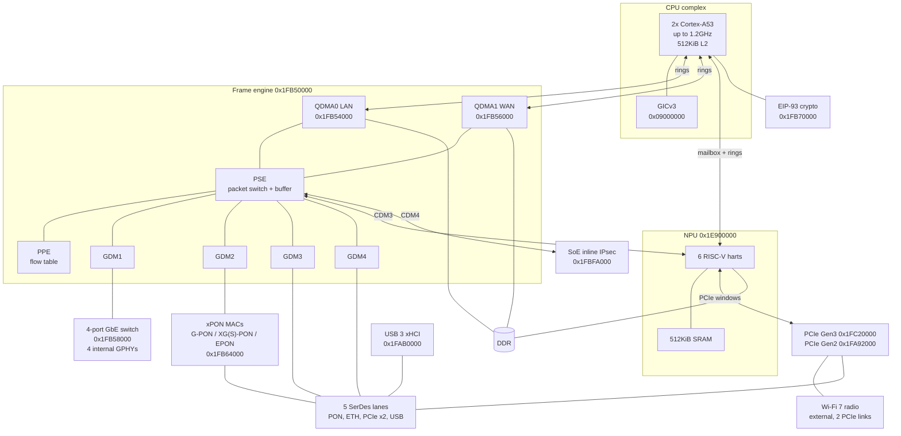

*Figure 1. Main blocks and data connections. Thin lines carry packets. The host CPU reaches every block over
MMIO; those links are not drawn.*

| item | value |
|---|---|
| Application CPU | 2x Arm Cortex-A53, 500MHz to 1.2GHz, shared 512KiB L2, 64-byte lines |
| Interrupt controller | GICv3, distributor at 0x09000000 |
| Packet engines | frame engine (PSE, 4 GDM MACs, 5 CDM DMA ports), 1 PPE, 2 QDMA |
| Flow table | 8K entries of 80 bytes in on-chip SRAM, 2 hash functions |
| Network processor | 6 RISC-V (RV32IMAC) harts, 512KiB NPU SRAM, 32KiB cluster SRAM |
| WAN | G-PON, XG-PON, XGS-PON, EPON, 10G-EPON MACs on one multi-rate SerDes |
| SerDes | 5 lanes: PON, Ethernet, PCIe Gen3, PCIe/Ethernet QPHY, USB3/Ethernet QPHY |
| Switch | MT7530-register-compatible, 4 user ports with built-in 10/100/1000 PHYs, 10G CPU port |
| Crypto | EIP-93 look-aside engine, SoE inline ESP engine, TRNG |
| Other I/O | 2 PCIe root complexes, USB 3 xHCI, eMMC, SPI-NAND, 5 UARTs, 2 I2C, PCM/SLIC, GPIO |
| Chip family code | 0x10 (bits 31:16 of SCU 0x1FB00064) |

---

## 3. Address map, interrupts and memory

### 3.1 MMIO map

All on-chip blocks sit between 0x1E900000 and 0x1FFFFFFF. DRAM starts at 0x80000000.

| range | block | GIC SPI |
|---|---|---|
| 0x09000000 | GICv3 distributor and redistributors | — |
| 0x1E900000 + 0x313000 | NPU host window (cluster SRAM, boot and mailbox registers) | 125 mailbox; 109-112, 134-137 watchdogs; 118-123 host rings |
| 0x1FA01800 | HSDMA (memory-to-memory DMA) | 63 |
| 0x1FA04000 / 0x1FA05000 / 0x1FA07000 / 0x1FA08000 / 0x1FA09000 | XSI MACs: PCIe-G3 lane, USB lane, QPHY lane, PON lane, ETH lane | — |
| 0x1FA0E000 | eMMC host | 170 |
| 0x1FA10000 | SPI-NAND controller (SNFI) | — |
| 0x1FA20000 + 0x388 | chip SCU (thermal sensors, pin and LED mux) | — |
| 0x1FA5A000 | PCIe Gen2 PHY (QPHY) | — |
| 0x1FA70000 / 0x1FA7E000 / 0x1FA7F000 | ETH lane PCS / PMA / analog | — |
| 0x1FA80000 / 0x1FA8E000 / 0x1FA8F000 | PON lane Ethernet-mode PCS / PMA / analog | — |
| 0x1FA92000 | PCIe Gen2 root complex | 40 |
| 0x1FAA1000 | TRNG (registers at +0x800) | 35 |
| 0x1FAB0000 / 0x1FAC0000 | USB 3 xHCI / USB PHY | 33 |
| 0x1FAF0000 | PON PCS and adaptation (FEC, sync, XG PHY) | 43 |
| 0x1FB00000 + 0x970 | NP SCU: clocks, resets, WAN mode, SerDes mux, MDIO masters | — |
| 0x1FB30000 | GDMA (simple copy engine) | — |
| 0x1FB50000 | frame engine (PSE, GDM, CDM, PPE, misc) | 49 |
| 0x1FB54000 / 0x1FB56000 | QDMA0 (LAN) / QDMA1 (WAN) | 37, 55-57 / 38, 58-60 |
| 0x1FB58000 | Ethernet switch | 209 |
| 0x1FB5E000 | switch IEEE 1588 unit | — |
| 0x1FB64000 / 0x1FB65000 / 0x1FB66000 | G-PON / XG(S)-PON / EPON MAC | 42 (shared) |
| 0x1FB70000 | EIP-93 crypto | 44 |
| 0x1FBD0000 | PCM controller | 27 |
| 0x1FBE1000 | high-speed UART 3 | 54 |
| 0x1FBE2300 | ToD generator | 78 |
| 0x1FBE3400 | peripheral bus control (bus timeouts) | — |
| 0x1FBE4000 / 0x1FBE5000 | mini-OLT MAC / OLT PCS | 216 / 215 |
| 0x1FBF0000 | UART 1 | 18 |
| 0x1FBF0100 | timers and watchdog | — |
| 0x1FBF0200 | GPIO and pin control | 26 |
| 0x1FBF0300 / 0600 / 0700 | UART 2 / 4 / 5 | 32 / 61 / 62 |
| 0x1FBF8000 / 0x1FBF8100 | I2C 0 / I2C 1 | — |
| 0x1FBFA000 | SoE inline IPsec engine | 79 |
| 0x1FC20000 | PCIe Gen3 root complex | 39 |
| 0x1FC7E000 / 0x1FC7F000 | PCIe Gen3 lane PMA / PHY | — |
| — | dying-gasp (power fail) | 34 |

### 3.2 Access to gated blocks

Some blocks only decode addresses while their mode is active. With the WAN lane in XGS-PON mode, these do not
answer: the G-PON/EPON PHY windows (0x1FAF0000, 0x1FAF3000, 0x1FAF4000), the PON-lane XSI MAC and its PTP block
(0x1FA08000, 0x1FA08500), the QPHY XSI MAC (0x1FA07000), the OLT PCS (0x1FBE5000-0x1FBE59FF) and the PCS of the
PCIe-G3 lane while it runs PCIe (0x1FC70000).

A read from such an address does not fault immediately. It goes through the following sequence:

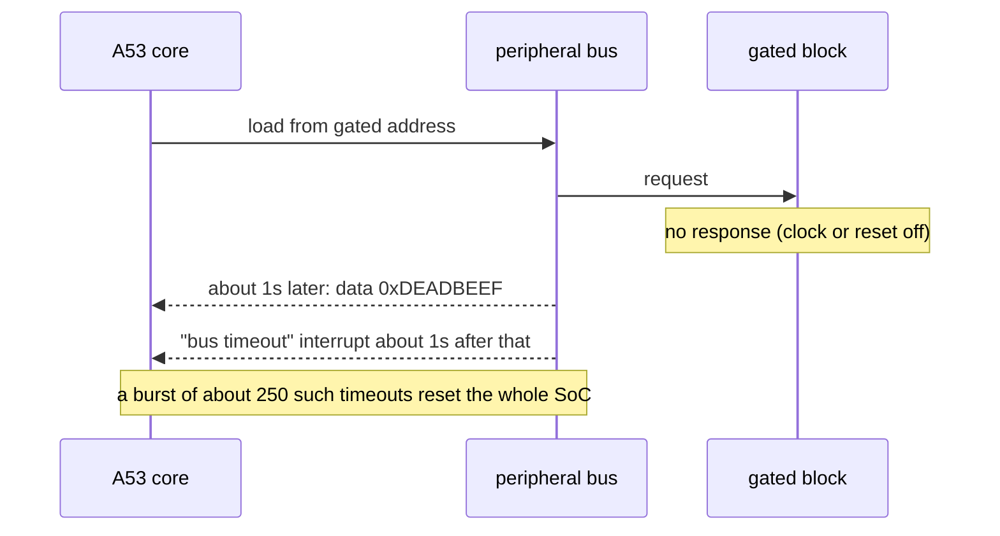

The test unit reset itself once when a register dump walked into the unimplemented part of the TRNG window,
+0x100 to +0x7FF. Drivers and debug tools therefore have to enable a block's clock and release its reset
before the first access. A tool that sweeps a window whose block may be off should read one word first and stop
at the first timeout.

Some windows decode but hold no data and return 0xDEADBEEF immediately, without a timeout. The G-PON MAC
window in XGS-PON mode is one of these.

### 3.3 DRAM carved out at boot

Several engines need physically contiguous DRAM outside the operating system's allocator. The reservations
on the test configuration:

| base | size | consumer |
|---|---:|---|
| 0x80000000 | 2MiB | secure monitor (BL31) |
| 0x84000000 | 10MiB | NPU code and data |
| 0x87000000 | 32MiB | QDMA0 hardware-forward payload buffers |
| 0x89000000 | 16MiB | QDMA1 hardware-forward payload buffers |
| 0x8A000000 | 24MiB | NPU Wi-Fi receive packet pool |
| 0x8B800000 | 26MiB | NPU Wi-Fi transmit packet pool |
| 0x8D200000 | 26KiB | NPU transmit buffer-id table |

*Figure 2. DRAM reserved at boot, about 110MiB in total.*

The NPU can only address DRAM between 0x80000000 and 0xC0000000, so every buffer it touches has to be in
the first GiB. This is irrelevant on a 512MiB system but constrains pool placement on larger memories.

---

## 4. CPU complex, boot and platform control

### 4.1 Cores, caches, interrupts

The two Cortex-A53 cores share a 512KiB unified L2. They are brought up through PSCI. The boot firmware's CPU
description lists four cores, but only two come online. Whether cores 2 and 3 exist in silicon is an open
question (§17). Interrupts arrive through a GICv3 at 0x09000000. A GIC ITS is not usable, so PCIe uses legacy
INTx or the root complex's own MSI logic.

DMA from the frame engine and the NPU is not coherent with the A53 caches. Software invalidates every receive
buffer and cleans every transmit buffer. §15 quantifies the cost: about a fifth of CPU time when the host
terminates TCP at gigabit rates.

### 4.2 Clocks, DVFS and thermal

CPU frequency is changed through secure-monitor calls, not by writing PLL registers from Linux. Fifteen
operating points from 500MHz to 1.2GHz in 50MHz steps map to performance levels 0-14 of the monitor's
DVFS service. Voltage scaling (AVS) is handled by the boot firmware.

Other blocks have their own clock domains. The boot firmware describes two operating points for each of them
on the test unit:

| domain | low / high (MHz) |
|---|---|
| CPU | 500 / 1200 |
| NPU | 400 / 720 |
| frame engine | 480 / 600 |
| system bus | 240 / 300 |
| DRAM controller (EMI) | 400 / 540 |
| SoE | 300 / 540 |
| ToD | 200 / 400 |
| AES | 300 / 400 |
| switch | 270 / 540 |

The NPU PLL select field in the NP SCU decodes to 666, 800, 720 or 600MHz.

Three thermal sensors are read through the chip SCU at 0x1FA20000: sensor 0 is a bandgap reference, sensor 1
sits in the gigabit PHY area and sensor 2 on the CPU die. The configuration used on the test unit puts the
passive trip, which throttles the CPU, on the bandgap sensor at 95°C and the critical trip at 120°C. The other
two sensors are read-only zones.

### 4.3 Boot chain and secure services

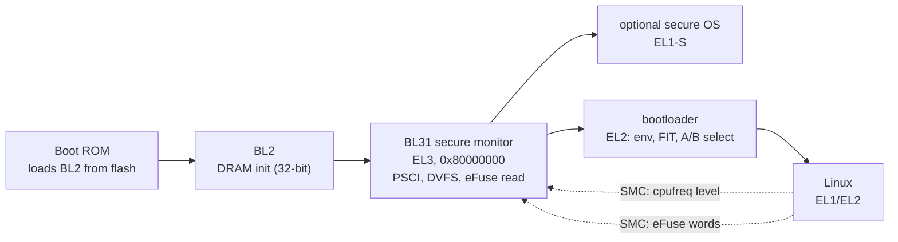

*Figure 3. Boot chain. Dashed lines are run-time calls into the secure monitor.*

eFuse contents (PCIe/PON termination trims, validity bits, PHY calibration) are not mapped for the
non-secure world. Linux reads them through a monitor call and exposes them as nvmem cells. The flash keeps two
kernel+rootfs copies for A/B updates. A calibration partition holds per-unit data: Wi-Fi EEPROM, optic
calibration, MAC addresses.

### 4.4 Pins, GPIO and LEDs

GPIO and pin control live at 0x1FBF0200: direction at +0x00 (2 bits per pin), data at +0x04, output enable
at +0x14. Pin groups route functions such as PON control signals, the NPU UART, and 1PPS outputs. An LED mux in
the chip SCU (0x1FA20214) chooses whether a pin carries a hardware LED signal or a plain GPIO.

The four built-in switch PHYs share one LED configuration block (MMD 0x1F, registers 0x21-0x27), so one port's
LED cannot be forced on or off without affecting the others. Per-port LED control from software requires
switching those pins to GPIO mode and driving them directly.

---

## 5. Frame engine

The frame engine (FE) at 0x1FB50000 connects all packet sources and sinks. It contains:

- the packet switch engine (PSE) and its on-chip buffer;
- four GDM Ethernet MACs (GDM1-4), which face the network;
- five CDM ports, which are DMA-facing;
- the PPE;
- two classifiers (VIP and IFC);
- a set of rate limiters, MIB counters and helpers.

### 5.1 PSE ports

Every packet inside the FE carries a PSE port number for its source and destination:

| PSE port | block | role |
|---|---|---|
| 0 | CDM1 | QDMA0 (LAN): CPU receive and hardware forward |
| 1 | GDM1 | internal switch CPU port (10Gbps internal link) |
| 2 | GDM2 | WAN: the PON MAC, or an Ethernet MAC on the PON SerDes |
| 3 | GDM3 | Ethernet on the ETH SerDes lane |
| 4 | PPE | the flow-offload engine |
| 5 | CDM2 | QDMA1 (WAN) |
| 6 | CDM3 | NPU host bridge |
| 7 | CDM4 | NPU TDMA (Wi-Fi) and the SoE IPsec engine |
| 9 | GDM4 | Ethernet on the PCIe-G3 lane (channel 0) or the USB lane (channel 1) |
| 10 | CDM5 | copy engine |
| 0xE | — | QDMA multicast replication |
| 0xF | — | drop |

The AN7583 has a single PPE. Port 8, the second PPE on larger family members, is absent.

### 5.2 Frame engine sub-blocks

| FE offset | sub-block |
|---|---|
| +0x000 | global configuration |
| +0x024 | WAN port select |
| +0x030 to +0x048 | "my-MAC" ranges for LAN and WAN (decide L3 vs L2 learning) |
| +0x100 | PSE (buffer pages, thresholds, port maps) |
| +0x1F0 / +0x1F4 | VIP / IFC enable per port |
| +0x200 | IFC: 64-rule TCAM classifier |
| +0x300 | VIP: 32 "send to CPU" patterns |
| +0x400, +0x1400, +0x1800, +0x2400, +0x2800 | CDM1-CDM5 |
| +0x500 (MIB +0x600), +0x1500, +0x1100, +0x2500 | GDM1, GDM2, GDM3, GDM4 |
| +0x800 / +0x900 | PDMA / TDMA (the NPU's link into the FE) |
| +0xE00 | PPE |
| +0xFDC to +0xFEC | Wi-Fi buffer return FIFO (§12) |
| +0x2008 | FORCE_SLOW (move fast-path traffic to DRAM queues when the buffer fills) |
| +0x2010 | fragment and reassembly force ports |
| +0x207C to +0x208C | tunnel template table access |
| +0x2100 | multicast VLAN table (64 tables x 16 ports) |
| +0x2240 | ingress rate limiter per source port |
| +0x2300 | WAN MTU table |

### 5.3 Fast path, slow path, CPU path

A packet that leaves the PPE with a decision takes one of three routes, selected per packet by the FAST and
FQOS bits of the matched flow entry, with a per-port default:

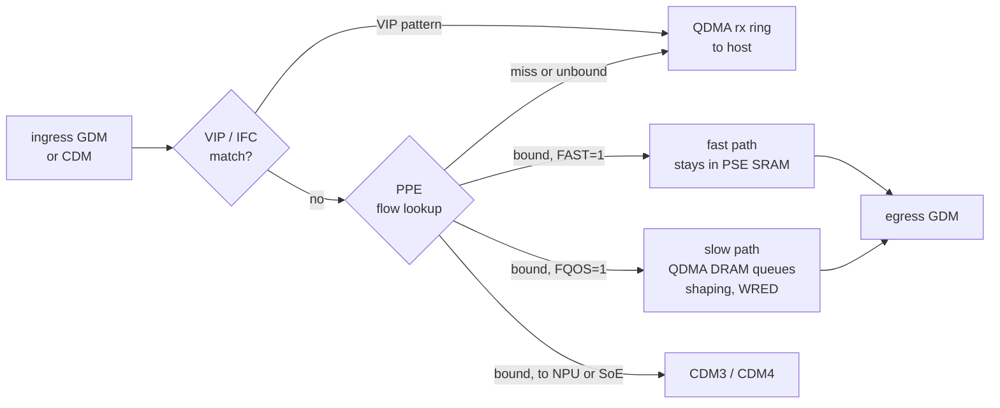

*Figure 4. Routes a packet can take through the frame engine.*

- **Fast path.** The packet stays in the PSE's 128-byte-page SRAM. Throughput is highest, but burst tolerance
  is limited to the on-chip buffer.
- **Slow path.** The packet is written to DRAM through QDMA, where channel shapers, queue schedulers and WRED
  apply. This path is required when QoS has to be accurate or when a fast port feeds a slow one.
- **FORCE_SLOW** (FE+0x2008) moves fast-path traffic to the slow path automatically when the shared buffer
  passes 1/3 or 2/3 occupancy.

### 5.4 Classifiers ahead of the PPE

- **VIP:** 32 patterns on ethertype, PPP protocol, IP protocol, or TCP/UDP port. A match goes to a chosen CPU
  ring and is never learned by the PPE. Control traffic (ARP, DHCP, PPPoE discovery, OMCI) is kept out of
  offload this way.
- **IFC:** a 64-rule TCAM. It matches on L2 fields (GEM/LLID, two VLANs, PPPoE session, MACs), L3/L4 fields
  (addresses, ports, DSCP, TCP flags, TTL) and user-defined offsets. A rule can force the packet to the CPU or to
  a port, assign a rate limiter id, a MIB counter or a meter group, and rewrite VLAN and DSCP. The hit index can
  also feed the PPE hash, for example to split one 5-tuple into per-DSCP flows.

### 5.5 Built-in traffic generator

The FE can expand one template frame into a stream of UDP packets. The template carries a 32-byte load
header. The FE splits it into payload-sized packets, stamps a sequence number and a timestamp into each one,
and fills the payload with a hardware pattern. The registers are FE+0x48C (shaper: enable bit 31, tick 30:29,
rate 28:8), FE+0x494 (header length and the sequence and timestamp offsets) and FE+0x498 (payload size,
pattern, generator enables).

A receive-side counterpart (FE+0x14A4) steers a matched flow to a QDMA ring. The hardware then counts bytes,
lost packets and out-of-order packets in the ring descriptors. Together they allow line-rate UDP tests
without the CPU generating or checking packets. The generator was identified by static analysis and was not
exercised on the unit.

---

## 6. QDMA

### 6.1 Two instances

QDMA0 (0x1FB54000) serves the LAN side and QDMA1 (0x1FB56000) the WAN side, including the PON. Each instance
has:

- 32 transmit and 32 receive descriptor rings with 18-bit ring indices;
- 4 interrupt banks and 2 transmit-completion queues;
- scatter-gather;
- receive interrupt coalescing (packet count, or time in 20µs units).

Each instance also performs hardware forwarding: packets the PPE sends to the slow path are queued here
without the CPU. It has a buffer manager of up to 16K descriptors in SRAM or 48K in DRAM, plus payload buffers in the
reserved areas of §3.3 (32MiB and 16MiB on the test configuration). The buffer manager can only be programmed
at init. Hardware-forwarded frames must be 48-2048 bytes and a multiple of 4.

### 6.2 Channels, queues and shapers

| resource | QDMA0 | QDMA1 |
|---|---|---|
| transmit channels | 48 | 32 |
| queues per channel | 8 | 8 |
| scheduler per channel | SP, WRR (16-bit weights, byte or packet mode), or SP on the top 2-7 queues with WRR below | same |
| hierarchical mode | each channel splits into 4 virtual channels | same |

The descriptor's channel field is 5 bits wide, so QDMA0 channels 32-47 can only be reached from hardware
forwarding (inferred).

Five token-bucket engines can each run as a rate limiter or as a trTCM, in byte or packet mode:

| engine | default tick | use |
|---|---|---|
| ingress trTCM | 125µs | meters; the first 32 limit the CPU receive rings |
| SLA trTCM | — | 4 SLA channels |
| egress queue rate limit | — | per-queue shaping |
| egress trTCM | 25µs | per-channel shaping |
| global rate control | — | one global limit |

Token rates are 18.6 fixed-point values per tick. A bucket size is 1KiB or 16 packets shifted left by 0 to 17,
with a minimum of 4096 bytes. Congestion control uses descriptor thresholds at total, channel and queue level,
with separate thresholds for DEI-marked frames, WRED with 5 thresholds and 4 drop probabilities, and queue
ageing.

Meter and accounting group numbers travel with each packet, in the transmit descriptor or the PPE flow entry.
Shaping groups come in three tiers of 63, 31 and 15, statistics groups in three tiers of 127, 63 and 31. The
PPE itself keeps no per-flow byte counters; these groups are the hardware's per-flow accounting.

### 6.3 Descriptor differences within the chip family

Transmit descriptor message word 0 has per-chip bit assignments. On the AN7583, bit 13 is PAD (the trigger
for the traffic generator of §5.5), bit 12 is IPv4 checksum and bit 11 is TCP/UDP checksum. A driver that sets
bits 11-13 together for checksum offload, following the layout of a sibling chip, also sets PAD on every
frame. This is harmless only while the generator is disabled.

Other offloads:

- **Transmit checksum and TSO.** The MSS is carried in the TCP checksum field. Segmentation happens after
  the QoS queues, so a TSO frame of up to 64KiB is scheduled as one unit.
- **Hardware LRO.** CDM1 and CDM2 have 8 aggregation contexts, bound to local-delivery PPE entries, with
  sequence and timestamp continuity checks. LRO is configured per QDMA, so only a device that has its QDMA
  to itself can use it.

### 6.4 Experiment: locating loss on the hardware forward path

**Setup.** The test was a Wi-Fi to LAN TCP upload on 5GHz with 4 streams. The flows were bound in the PPE and
forwarded by QDMA0 to a 1Gbps switch port.

**Symptom.** Throughput was 543-678Mbps with about 3,000 TCP retransmissions every 10s, and no error counter
incremented.

**Method.** A counter was read at every hand-over point:

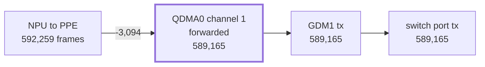

*Figure 5. Per-stage counters for one run. The loss sits between the PPE and the QDMA forward queue.*

**Finding.** About 3,000 frames were dropped between the PPE and the QDMA forward queue, in bursts of 10-30
across all flows at once. The bursts were A-MPDUs arriving from the radio faster than the gigabit port drained
them. Congestion drop was enabled, but the dynamic thresholds at QDMA +0x10A4 to +0x10AC and +0x10D4 to +0x10DC
were still at their reset values, which are too small for bursts of that size.

**Result.** With the thresholds programmed, the same test ran at 900-915Mbps with about 260 retransmissions
and a ping p99 of 26ms under load. Congestion drop remains enabled, so the queue stays bounded.

---

## 7. PPE: the flow-offload engine

### 7.1 Table and entries

The PPE (FE+0xE00, 0x1FB50E00) keeps a flow table, the FOE table, of 80-byte entries.

| property | AN7583 |
|---|---|
| SRAM table | 512 to 16K entries; 8K used (TB_CFG bits 26:24 = 3) |
| DRAM table | up to 63.5K entries; 16K can be reserved, but lookup is disabled (TB_HASH_CFG bit 16 = 0) |
| hash | two SRAM hash functions (modes 0 and 1), so each flow has two candidate slots |
| seed | HASH_SEED (0xE44) = 0x12345678 |
| software access | RAM_CTRL (0xF1C, `index << 8 \| 3`) and RAM_DATA (0xF20) |
| per-entry counters | none; flow statistics come from QDMA accounting groups |

Effective capacity is 8K flows with two-choice placement.

Entry types:

| type | flows |
|---|---|
| 0 | IPv4 NAPT (5-tuple, address and port rewrite) |
| 1 | IPv4 route (3-tuple) |
| 2 | L2 bridge |
| 3 | DS-Lite (IPv4 in IPv6) |
| 4 | IPv6 3-tuple |
| 5 | IPv6 5-tuple |
| 6 | IPv6 multicast route |
| 7 | 6RD (IPv6 in IPv4) |

Every entry shares an action layout:

| word | important fields |
|---|---|
| IB1 | 31 static, 29:28 state, 27:25 type, 23 tunnel decap, 21:20 VLAN TPID mode, 19:16 VLAN layers, 15 keep-alive, 14:0 timestamp |
| IB2 | 31:24 DSCP, 23:13 accounting groups, 11 multicast, 10 FAST, 9 FQOS, 8:5 forced PSE port, 4:0 sub-queue (NBQ) |
| DATA | 31:24 UDF (steers the NPU), 23:16 meter id, 15:11 QDMA channel, 10:8 queue, 6 tunnel, 5:0 tunnel id |
| METER | 31:16 tunnel MTU, meter and accounting groups |
| HOP | four 3-bit hop codes (6 = add tunnel, 7 = remove tunnel) |
| L2 | VLAN tags, destination and source MAC (or an index into a 16-line MAC table), PPPoE session |

The L2 `etype` field is overloaded. On a switch port it is a special-tag port bitmap. On a Wi-Fi flow it holds
the radio band (bit 11) and station index (bits 10:0). On a PON flow it holds the GEM port.

### 7.2 Flow life cycle

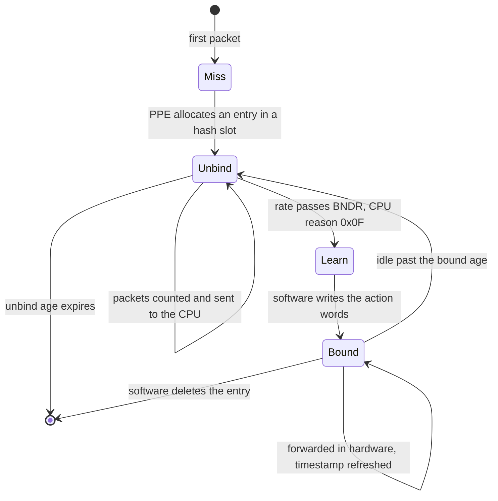

*Figure 6. Flow states in the PPE. Bind rate 30 packets/s; bound ages UDP 60s, TCP 60s, TCP FIN 5s, other 15s.*

The hardware creates the entry and counts packets; software decides whether to bind and supplies the rewrite.
The CPU is informed of a candidate through the receive descriptor, which carries the FOE index and a 5-bit CPU
reason (CRSN):

| CRSN | meaning |
|---|---|
| 0x07 | no flow assigned |
| 0x08 / 0x09 | fragment (IPv4 NAT / NAPT or DS-Lite) |
| 0x0C | TCP SYN/FIN/RST (never bound) |
| 0x0D | FOE miss |
| 0x0E | hit an unbound entry |
| **0x0F** | **hit an unbound entry, bind rate reached: bind now** |
| 0x13 to 0x15 | keep-alive copies of bound flows (refresh software timers) |
| 0x16 | bound, but forced to the CPU (NPU or crypto steering) |
| 0x18 / 0x19 | bound multicast, copy to CPU |
| 0x1C / 0x1D | bound, but exceeds MTU |
| 0x1E | did not pass through the PPE |

Keep-alive (TB_CFG KA_CFG) makes the PPE send one copy per bound flow per period, so connection-tracking and
bridge timers in software stay fresh. With keep-alive off, software must refresh them from the entry
timestamps instead.

### 7.3 Bring-up register sequence

About 25 register writes put the PPE into a working state. The main ones are listed below with the values for
a standard router configuration:

| register (FE offset) | value | effect |
|---|---|---|
| FLOW_CFG (0xE04) | IPv4 NAT/NAPT, IPv6 3T/5T, multicast keys, GRE-key hash | which flow types are learned |
| IP_PROT_CHK, IP_PROT_0..3 (0xE08-0xE18) | 0x000F000F, 0x04291106, 0x00003A01 | IP protocol list (TCP, UDP, ICMP, IPv6, IPIP, ICMPv6) |
| L2B_CFG (0xE88) | 0x001D0F7F | L2 bridge key fields; IP ethertypes excluded so IP is always learned at L3 |
| L2B ethertypes (0xED0-0xEEC) | 0x8100, 0x88A8, 0x0800, 0x86DD, packed two per register | ethertypes kept out of L2 learning |
| MTU_0..3 (0xF04-0xF10) | 2000 + 4 bytes per VLAN layer | exceed-MTU thresholds |
| TB_CFG (0xE1C) | SRAM 8K, DRAM 16K, ageing and keep-alive enables | table geometry |
| TB_HASH_CFG (0xE50) | SRAM hash 0 + hash 1 on, DRAM off | lookup |
| BNDR (0xE28), BIND_LMT0/1 | 30pkt/s; quotas 4000/4000/8000 | when to offer a flow for binding |
| UNB_AGE, BND_AGE0/1 (0xE38-0xE40) | bound ages as in figure 6 | ageing |
| GLO_CFG (0xE00) | enable, padding, NPTv6, pass-through | turns the engine on |
| GDMx FWD (FE+0x500, +0x1500, +0x2500) | UC/BC/MC to port 4 | send ingress traffic to the PPE |

**Register state read on the running unit:**

| register | value |
|---|---|
| GLO_CFG (0xE00) | 0x00079743 |
| FLOW_CFG (0xE04) | 0x1EB9F700 (bits 27/28 hash ESP flows by SPI) |
| TB_CFG (0xE1C) | 0x83C0FFB4 |
| fragment force ports (FE+0x2010) | 0x001600C3 |

Two of the GLO_CFG bits and several TB_CFG bits set on the unit are undocumented (§17).

**DSCP rewrite (erratum).** GLO_CFG bit 11 is described as the DSCP remark enable and is clear on the unit.
The PPE nevertheless writes the IB2 DSCP value into every forwarded packet, so an entry with DSCP 0 strips the
marking of a flow. Software that offloads flows has to fill IB2 DSCP per direction, otherwise priority marking
is lost on every hardware-forwarded packet.

### 7.4 Further PPE features

NAPT, routing and bridging use only part of the PPE. It also has:

- **Tunnels.** A 64-entry tunnel template table for GRE/GRETAP, VXLAN, L2TPv2/v3 and UDP encapsulation. An
  encap is one PPE pass; a decap is two (outer entry with hop "remove", then the inner entry). DS-Lite and
  6RD use per-entry indices into a 16-line address table.
- **NPTv6** with a 16-prefix table.
- **Multicast replication.** Three mechanisms: the switch's port bitmap, QDMA replication with the 64-table
  multicast VLAN map, or a copy to the CPU for Wi-Fi.
- **Meters and accounting** per flow, through the groups in §6.2.
- **Fragment handling.** Oversized or fragmented bound flows go to a force port (FE+0x2010) for software or
  NPU handling.
- **NPU steering.** A bound flow with forced port CDM3 and a UDF value goes through an NPU service (VXLAN,
  SRv6, MAP-T assists, L4S marking; see §11).

### 7.5 Observations

- Wired LAN-WAN routing with bound flows runs at line rate at about 0.01 host cores.
- Routed multicast placed in the PPE before the first packet arrives (one entry per group) forwards a stream
  from its first packet at 100Mbps with 0% loss. Hardware multicast forwarding was tested up to
  900Mbps.
- A multicast group whose receivers sit behind two different GDMs (for example a switch port and the GDM3
  Ethernet WAN) cannot be replicated by one entry and stays in software.

---

## 8. Ethernet switch and PHYs

The switch at 0x1FB58000 is register-compatible with the MT7530 family: its revision register reads
0x75300001. It has four user ports, each with a built-in 10/100/1000 PHY on the switch's internal MDIO
(addresses 9-12, PHY ID 0xC0FF0420). CPU port 6 is wired to GDM1 as a fixed 10Gbps internal link.

| feature | capacity |
|---|---|
| address table | 1024 entries, SVL/IVL with 8 FIDs |
| VLANs | 4K, double tagging |
| queues | 8 per port, SP/WFQ, minimum and maximum shapers |
| rate limits | per-port ingress token bucket and egress limiter |
| ACL | 32 rules with a trTCM meter table |
| counters | 40 MIB counters per port |
| other | port isolation, 802.1X, per-port learning limits, storm control, IGMP/MLD snooping assist, EEE, WoL, IEEE 1588 unit at 0x1FB5E000 |

**Special tag in the DMA descriptor.** Older chips of this family insert a 4-byte tag into each frame between
the CPU MAC and the switch. On the AN7583 the destination port bitmap (DP[5:0], several ports at once) is
carried in the QDMA transmit message, and the source port in the receive message. Frames on the GDM1 link are
untagged. A driver passes the port information to the network stack as metadata rather than frame bytes.

The built-in PHYs need calibration at boot: resistor, 50Ω termination and TX offset/amplitude tables, from
eFuse. It takes about 0.8s per port.

External PHYs attach through two SoC MDIO masters in the NP SCU (0x1FB000C8 and 0x1FB000CC). On the test unit,
three 2.5Gbps PHYs with their own microcontroller firmware sit behind the PON, ETH and USB SerDes lanes.

---

## 9. SerDes lanes, PCS and XSI MACs

### 9.1 Five lanes, many roles

The AN7583 has five SerDes lanes. Each lane can take one of several roles, and each Ethernet role has its own
PCS and an "XSI" MAC that connects to a GDM:

| lane | PMA / analog | Ethernet PCS | XSI MAC | roles | FE port |
|---|---|---|---|---|---|
| PON | 0x1FA8E000 / 0x1FA8F000 | 0x1FA80000 | 0x1FA08000 | PON (all rates), 10GBASE-R/USXGMII, 2500BASE-X, SGMII | GDM2 |
| ETH | 0x1FA7E000 / 0x1FA7F000 | 0x1FA70000 | 0x1FA09000 | 10GBASE-R/USXGMII, 5GBASE-R, 2500BASE-X, SGMII, mini-OLT | GDM3 |
| PCIe-G3 ("2-lane PHY") | 0x1FC7E000 / 0x1FC7F000 | 0x1FC70000 | 0x1FA04000 | PCIe Gen3/Gen2 x1, or USXGMII/10GBASE-R/2500BASE-X | GDM4 ch0 |
| QPHY-PCIe | 0x1FA5E000 / 0x1FA5F000 | 0x1FA50000 | 0x1FA07000 | PCIe Gen2, or 2500BASE-X/SGMII | GDM4 ch0 |
| QPHY-USB | 0x1FA6E000 / 0x1FA6F000 | 0x1FA60000 | 0x1FA05000 | USB 3, or 2500BASE-X/SGMII (USB 2 still available) | GDM4 ch1 |

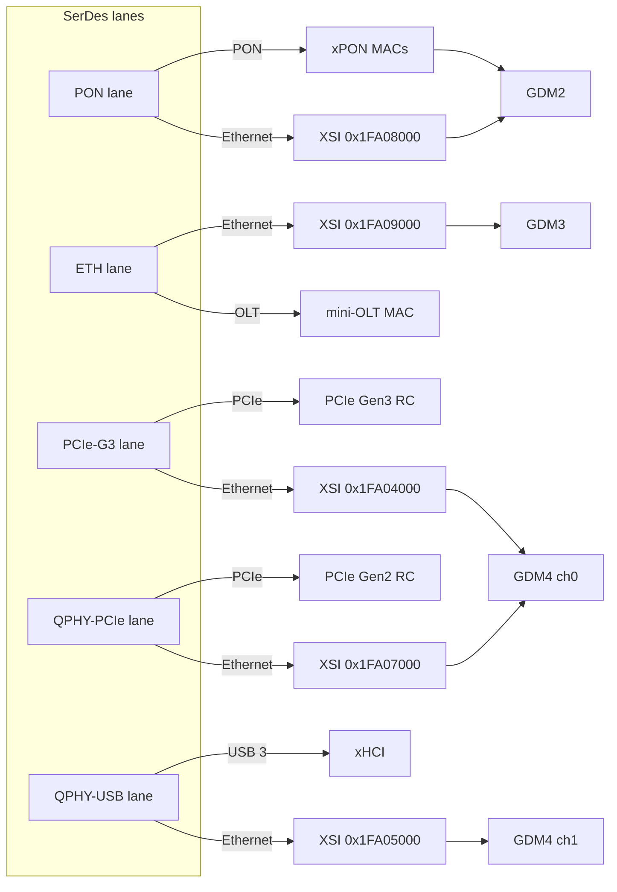

*Figure 7. Lane roles. Each lane runs exactly one role at a time.*

The two PCIe-capable lanes share GDM4 channel 0, so at most one of them can be an Ethernet port at a time
(inferred).

### 9.2 Role selection

The role is selected by fields in the NP SCU. They are written once, at lane bring-up:

| register | field | meaning | value read on the unit |
|---|---|---|---|
| WAN_CONF 0x1FB00070 | 7:0 | PON lane mode (table in §10.2); Ethernet modes SGMII 0x10, 2500BASE-X 0x11, BASE-R 0x12 | 0x0A (XGS-PON) |
| WAN_CONF 0x1FB00070 | 24 / 25 | mini-OLT enable / OLT symmetric | 0 |
| SSR3 0x1FB00094 | 14:13 | ETH lane: 1 = USXGMII, 2 = 2500BASE-X/SGMII | 2 |
| SSR3 0x1FB00094 | 29 | QPHY lanes: 0 = Ethernet-capable mux | — |
| SSTR 0x1FB0009C | 10:9, 12:11, 14:13 | PON, PCIe-G3, QPHY-PCIe lane mux | 0, 0, 0 (SSTR = 0x109) |

WAN_CONF[7:0] carries both the PON modes, which the PON driver sets, and the Ethernet modes of the same lane,
which the Ethernet PCS driver sets. The field therefore needs a single owner in software.

Line rates on the ETH lane: 10.3125GBd (USXGMII/10GBASE-R), 5.15625GBd (5GBASE-R), 3.125GBd (2500BASE-X)
and 1.25GBd (SGMII). 10GBASE-R is not a separate PCS mode: it is USXGMII at 10G with auto-negotiation off.
The lane stays at its line rate while an external PHY rate-adapts to the copper side, so the QDMA channel
feeding it has to be shaped to the negotiated rate, or the PHY's buffer overflows.

### 9.3 Observation: one lane, two consumers

On the test unit the ETH lane drives an external 2.5G PHY and also runs to an SFP cage on shared traces.
With the PHY running, the cage signal is disturbed; with the PHY held in reset, it is dead. With the PHY
powered down over MDIO (BMCR = 0x1940), the cage links:

- **10GBASE-R block lock.** The PCS status at 0x1FA75930 reads 0x100D.
- **No frames at 10G.** The XSI MAC status at 0x1FA09004 reports a local fault, generated between the PCS and
  the MAC. The same happens on the unit's original firmware, so the 10G rate-adaptation receive path is still
  unexplained (§17).
- **2500BASE-X.** Sync is reached on a loopback module.

Shared lanes of this kind are to be expected on AN7583 boards, since there are five lanes for more than five
possible connectors. Software then has to switch lane roles and PHY power states at run time.

---

## 10. xPON

### 10.1 Three MACs, one SerDes

| block | base | modes |
|---|---|---|
| G-PON MAC | 0x1FB64000 | G-PON 2.5/1.25, symmetric 2.5/2.5, point-to-point |
| XG(S)-PON MAC | 0x1FB65000 | XG-PON 10/2.5, XGS-PON 10/10; NG-PON2 register fields present |
| EPON MAC | 0x1FB66000 | EPON, 10G-EPON 10/1 and 10/10, Turbo-EPON 2.5 |
| PON PCS / adaptation | 0x1FAF0000 | FEC, sync, BIP/LOF, XG PHY (RX sync +0xA04, TX ctrl +0xA08, IRQ +0xA10/0xA14, FEC +0xA84) |

All three MACs share interrupt SPI 42. The PON PCS raises SPI 43, which includes the rogue-ONU detector, and
the power-fail (dying-gasp) input is SPI 34.

The MACs contain no VLAN, classification or filter tables. Service mapping (which VLAN goes to which GEM
port, how multicast is tagged) is decided in software and executed by the PPE.

### 10.2 Mode select

The lane mode is WAN_CONF[7:0] in the NP SCU:

| value | mode | value | mode |
|---|---|---|---|
| 0 | G-PON 2.5/1.25 | 9 | XG-PON 10/2.5 |
| 1 | EPON | 10 (0x0A) | XGS-PON 10/10 |
| 5 | G-PON point-to-point | 11-13 | NG-PON2 variants (fields only) |
| 6 / 7 | 10G-EPON 10/1, 10/10 | 16-18 | Ethernet SGMII, 2500BASE-X, BASE-R |
| 8 | 1/1 on the 10G path | 20 / 21 | G-PON symmetric / Turbo-EPON |

### 10.3 Connection to the frame engine

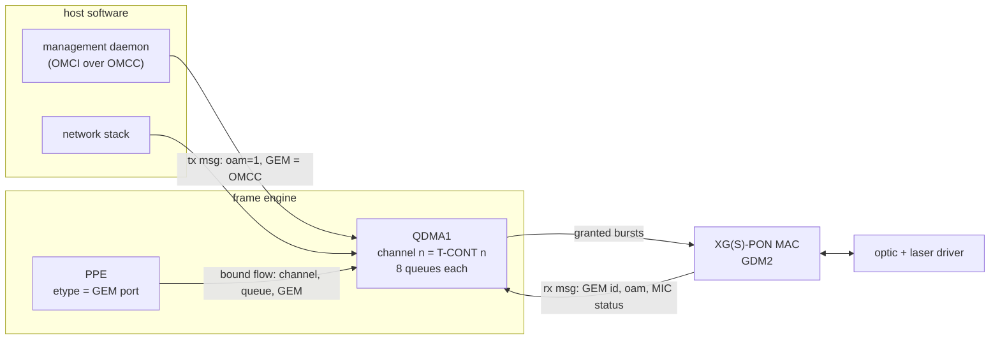

*Figure 8. PON datapath. A T-CONT is a QDMA1 channel; a GEM port is a descriptor field.*

- **T-CONT = QDMA1 channel.** Each of 32 channels has 8 priority queues. Upstream transmission is driven by
  the OLT's grants, so all upstream traffic, offloaded or not, goes through QDMA1.
- **GEM port in the descriptor.** Transmit message word 0 carries queue[2:0], channel[7:3], oam[8] and
  GEM[29:14], plus a MIC key index (bit 30). Receive messages carry the 16-bit GEM/LLID, the oam flag and a
  MIC failure flag.
- **OMCI** frames are ordinary QDMA frames with the oam bit set and the OMCC GEM. The XG(S)-PON MIC is
  computed in hardware.
- **Capacity.** 32 T-CONTs and up to 256 GEM ports in XGS-PON mode.

### 10.4 Activation

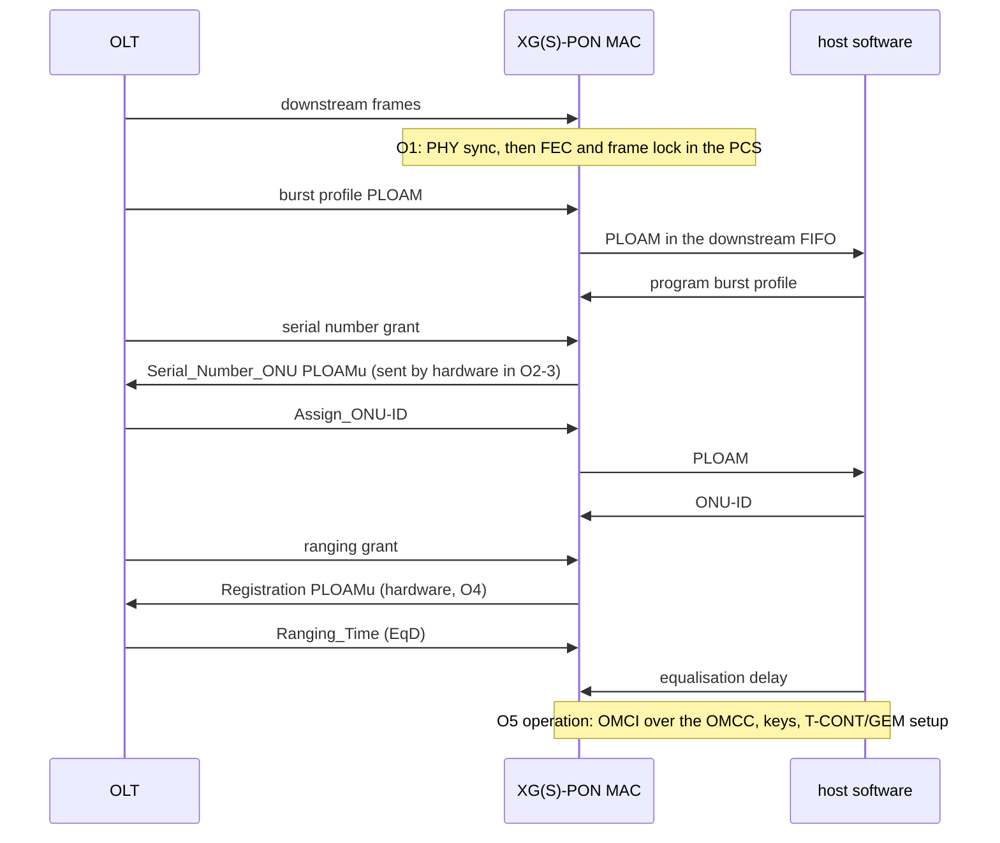

*Figure 9. XGS-PON activation. Hardware sends the time-critical upstream PLOAMs; software parses every
downstream PLOAM and runs the state machine.*

Encryption is done by hardware engines that software keys:

- **G-PON:** downstream AES-128 per GEM, with active and shadow keys switched at a superframe count.
- **XG(S)-PON:** unicast and broadcast key indexes, upstream AES, and registers that derive the key
  hierarchy.
- **EPON:** per-LLID AES or triple churning.

Software also handles PLOAM parsing, the O1-O7 state machine, OMCI and the policy behind T-CONT/GEM mapping.
On the test unit the ONU reached O5 about 34s after power-on, with roughly −26dBm received optical power on
the test link.

### 10.5 Burst-mode SerDes and optics

The PON SerDes is the same multi-rate IP as the Ethernet SerDes. It adds burst-mode transmit and
loop-timing: the transmit clock is derived from the recovered receive clock.

| register | function |
|---|---|
| 0x1FA8E270 bit 8 | burst-enable (BEN) polarity |
| 0x1FA8E960 | force BEN / continuous transmit (test) |
| 0x1FAF093C bit 0 | LOS polarity |

The receive bring-up sequence is: preset, lock to reference, offset/PI/signal-detect calibration, lock to
data, equaliser scan, then RX ready. A plug-in/plug-out state machine drives it. The lane also has PRBS7-31
generators and checkers, BIST and an eye scan.

The optic is controlled by an external laser-driver IC on I2C. On the test unit it answers at addresses
0x50/0x51 with 16-bit register addresses and contains its own microcontroller, which runs the APC/ER loops and
DDMI. The host loads that microcontroller's firmware and a per-unit calibration block at boot; afterwards it
reads monitoring values (temperature, bias, TX and RX power) and handles alarms and APD bias.

### 10.6 Observations

- PPPoE upstream over a GEM port was offloaded in the PPE in both directions: the PPE inserts the PPPoE header
  and the GEM goes in `etype`.
- Bridged IPTV multicast on its own GEM port (tagged, with PCP) was forwarded in hardware to switch ports.
- The G-PON/EPON PHY windows are dead while the lane is in XGS-PON mode (§3.2), so a monitoring tool must check
  the mode before reading.

The SoC also has a G.984 mini-OLT MAC (0x1FBE4000, SPI 216) and an OLT PCS (0x1FBE5000, SPI 215) on the ETH
lane, for fibre-to-the-room designs in which the gateway is itself an OLT for small ONUs. Static analysis
shows that its dynamic bandwidth allocation runs on NPU hart 5. It was not tested.

---

## 11. NPU: the RISC-V network processor

### 11.1 The cluster

| item | value |
|---|---|
| cores | 6 harts, RV32IMAC, per-hart data caches (not coherent with each other) |
| clock | PLL select 666 / 800 / 720 / 600MHz |
| NPU SRAM | 512KiB at NPU address 0x3E800000 |
| cluster SRAM | 32KiB at NPU address 0x3E900000 (also the start of the host window) |
| interrupt controller | PLIC at NPU address 0x0C000000 |
| MMIO seen by the harts | NPU registers 0x1EC00000, frame engine 0x1FB50000, PCIe windows |
| code | in DRAM at 0x84000000 (fetched through the I-cache) |
| DRAM reach | 0x80000000-0xBFFFFFFF |
| copy engine | one shared GDMA, about 2Gbps for all copies |

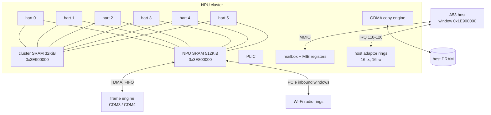

*Figure 10. NPU cluster and its connections.*

### 11.2 Host window registers

The host sees the cluster through a 0x313000-byte window at 0x1E900000. Offset 0 is cluster SRAM.

| offset | register |
|---|---|
| 0x305000 + n x 0x100 | hart n program counter (debug read) |
| 0x306000 | BOOT_TRIGGER |
| 0x306004 | BOOT_CONFIG (applies only on a 0 to 1 edge of BOOT_TRIGGER) |
| 0x306020 + n x 4 | boot base per hart |
| 0x30C000 | mailbox interrupt status |
| 0x30C030 + q x 0x10 | mailbox queue control |
| 0x30C140 + n x 4 | MIB scratch registers (MIB10 = boot block address) |
| 0x30D030 | host adaptor status (bit 16+n = rx ring n index changed; write 1 to clear) |
| 0x30D034 / 38 / 3C | host adaptor masks for interrupt lines 0-2 |
| 0x30D080 + n x 0x10 | host adaptor tx ring n: base, size, producer, consumer |
| 0x30D180 + n x 0x10 | host adaptor rx ring n |

### 11.3 Boot

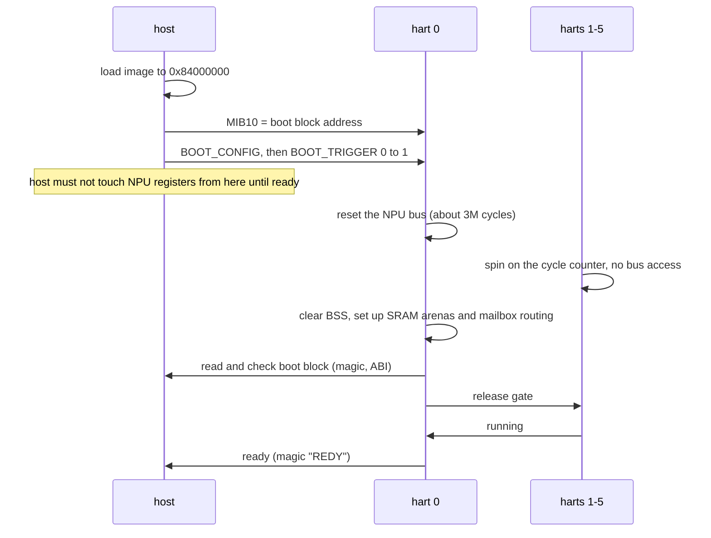

*Figure 11. NPU boot handshake.*

The bus reset at the start of boot is an erratum to design around. A host access to any NPU register during
that window hangs the host bus, so the host has to poll shared memory for the ready flag instead of a register.
With firmware that resets the bus first and uses no fixed delays, "ready" arrived 8.5ms after the trigger on
the test unit.

Each hart has a watchdog interrupt line (SPI 134-137, 109-112), so a firmware fault can be detected by the
host, which can then fall back to software paths.

### 11.4 Memory access costs

The harts' data caches are not coherent with each other or with the host. Consequences:

- State shared between harts must live in SRAM.
- Host rings in DRAM must be read uncached, or cached with explicit line invalidates.
- Each hart's private state belongs in cached DRAM, on its own cache lines.

Load latency measured on the harts:

| memory | cycles per load |
|---|---:|
| hart's own DRAM data, cache hit | ~10 |
| cluster SRAM | 17 |
| NPU SRAM | 18 |
| host DRAM, uncached | 98 |

*Figure 12. One uncached DRAM load costs about ten cache hits. A descriptor walk that reads three uncached
words per frame spends about 300 cycles per frame on those loads alone.*

### 11.5 Per-frame cost

Copying payload with the shared GDMA dominates whenever frames move between the radio and the host. Passing
buffers by reference avoids it:

| path | NPU cycles per 1500-byte frame |
|---|---:|
| Wi-Fi to host, payload copied by GDMA | ~5,800 |
| host to Wi-Fi, payload copied (worst case) | up to ~7,800 |
| LAN to Wi-Fi, descriptor only (tx hart) | ~2,350 |

*Figure 13. NPU cycles per frame by path.*

At 2,350 cycles per frame, the LAN to Wi-Fi path at 1.42Gbps used about 37% of one hart. Lending receive
pool buffers to the host instead of copying them (§12.4) reduced host CPU per Mbps from 0.066% to 0.058% on
bridged traffic. On host-terminated receive the same change raised throughput from 1,140 to 1,307Mbps while CPU
load fell from 84% to 77%.

### 11.6 Hart assignment

The division of work used for two-band Wi-Fi offload:

| hart | task |
|---|---|
| 0 | control: commands from the host, events, statistics, health |
| 1 | receive: walks the radio's completion ring, sends 802.3 frames to the PPE or the host |
| 2 | transmit: LAN to Wi-Fi descriptors, host descriptors, transmit-done reports, queue management |
| 3 | host channel: rings to the host by buffer id, interrupt moderation |
| 4 | buffers: id pool, receive refill, PPE buffer returns |
| 5 | spare: DBA for the mini-OLT, tunnels, fragment and L4S services |

Hand-overs between harts use single-producer/single-consumer rings in SRAM, with no hardware mutex per frame;
each object has one owner at a time. The NPU also hosts per-packet services the PPE cannot perform by itself:
VXLAN and SRv6 encap/decap, MAP-T assists, two-fragment IPv4/IPv6 fragmentation and reassembly, and L4S ECN
marking on queue depth. These are reached through PPE entries that force CDM3 with a UDF value.

---

## 12. Wi-Fi attachment and offload

### 12.1 PCIe topology

The AN7583 has two different PCIe root complexes:

| controller | base, IRQ | PHY / lane | memory window | on the test unit |
|---|---|---|---|---|
| Gen3-capable | 0x1FC20000, SPI 39 | 0x1FC7F000, PCIe-G3 lane | 0x20000000 | radio's second function, 5GHz band |
| Gen2 (older design) | 0x1FA92000, SPI 40 | 0x1FA5A000, QPHY lane | 0x24000000 | radio's main function, 2.4GHz band |

The radio is a dual-band Wi-Fi 7 chip (802.11be, 2x2 on 2.4GHz plus 2x2 on 5GHz, up to 160MHz). It shows
up as PCI device 14c3:7993 with a second function 14c3:799b. Each function sits on its own root complex, one
band per link, and both links train at 5GT/s x1. Interrupts are legacy INTx, one per link.

The radio has a single embedded MCU and reorders received A-MPDUs in hardware; the host or NPU reads in-order
frames from a completion ring.

| radio DMA ring | use |
|---|---|
| tx 18 / tx 21 (and 22) | data, 2.4GHz / 5GHz link |
| rx 8 / 9 | received data |
| rx 6 / 7 | transmit-free reports from the MAC |
| rx 0 / 1 | MCU events |
| tx 16 / 17 | firmware download / MCU commands |

### 12.2 How the NPU reaches the radio

The NPU has no PCIe DMA engine of its own. Each root complex instead has an **inbound window** that maps part
of NPU SRAM into the radio's address space: registers 0x1FA90038/3C on the Gen2 side and 0x1FC28030/34 on the
Gen3 side. The radio reads its rings, which the NPU places in SRAM, and writes completions there directly.

One exception was found by experiment: the radio writes **transmit-free reports only to host DRAM**. With
those rings in NPU SRAM no reports arrive, transmit tokens are never returned, and all radio DMA stops after a
few thousand frames. The receive data path and the transmit descriptor path work from SRAM.

### 12.3 The offload datapath

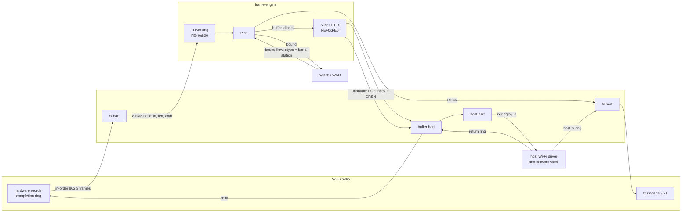

*Figure 14. Wi-Fi offload. Bound flows do not reach the host; unbound frames reach it together with the
PPE's result, so the host can bind them.*

Frame engine registers on this path:

| register | content |
|---|---|
| FE+0x800 | TDMA transmit ring (NPU to PPE). Descriptor = 8 bytes: word 0 = 0x40000000 \| id << 14 \| length, word 1 = buffer address |
| FE+0xFE0 | buffer FIFO head: bit 31 valid, bit 30 bound, bits 15:0 buffer id; write 0x80000000 to pop |
| FE+0xFDC | FOE index (14:0) and CPU reason (20:16) of the popped entry |
| FE+0xFE8 | FIFO configuration: enable (bit 16), drop unhit (bit 20) |
| FE+0xFEC | CPU-reason mask. It must keep reason 0x1F ("hit a bound entry"), or bound frames come back as unbound |

On the transmit side, a bound LAN to Wi-Fi flow has forced port CDM4, NBQ = band, and `etype` = band << 11 |
station index. The PPE pushes it to the NPU through TDMA, and the tx hart writes a radio descriptor into the
band's ring. The host does not see the frame.

### 12.4 Experiments: software path vs hardware path

**CPU load.** The same traffic was run with the same clients on both paths. On the software path the host
driver moves every frame; on the hardware path the PPE and NPU do.

| traffic | software path | hardware path |
|---|---|---|
| WAN to Wi-Fi (routed) | 0.95Gbps, 80% CPU | 1.40-1.46Gbps, ~5% CPU |
| Wi-Fi to WAN (routed) | ~50% CPU | 0.60-0.62Gbps, 3.5% CPU |
| Wi-Fi to LAN, 5GHz (bridged) | 896Mbps, 62% CPU | 915Mbps, 2.2% CPU |

*Figure 15a. Host CPU load for the same traffic on the software and hardware paths.*

**Throughput.** These runs were LAN to Wi-Fi on 5GHz with 4 streams:

| test | software path | hardware path |
|---|---:|---:|
| TCP | 761Mbps | 857Mbps |
| UDP 1472-byte | 651Mbps (31.8% loss) | 925Mbps (3.2% loss) |
| UDP 64-byte | 35.3Mbps (73.6% loss) | 133Mbps (0.2% loss) |

*Figure 15b. 64-byte throughput rises from 35 to 133Mbps. The large-packet results are at the 1Gbps limit of
the LAN client.*

**Band throughput** on the hardware path:

| case | Mbps |
|---|---:|
| 2.4GHz, 2x2 client, download / upload | 400 / 419 |
| 5GHz, Wi-Fi 7 client, single stream / upload | 1,470 / 1,407 |
| 5GHz, Wi-Fi 6 client, download | 1,776 |
| both bands at once | 2,071 |

*Figure 16. Wi-Fi throughput through the hardware path.*

**Queue delay with NPU queue management.** The radio reports each frame's in-chip delay in its transmit-free
reports, in a field with about 1ms resolution. NPU firmware can use that as the sojourn time for a CoDel-style
queue manager on the LAN to Wi-Fi path. The following was measured with 16 TCP streams on 2.4GHz:

| NPU queue management | in-chip delay |
|---|---|
| on | 16-19ms |
| off | 41-152ms |

Throughput was the same in both cases.

*Figure 17. In-chip queueing delay with and without NPU queue management.*

### 12.5 Radio measurement features

The radio firmware has measurement features beyond normal operation, reachable through its command interface:

- channel state information per received PPDU (64 tones at 20MHz, 512 at 160MHz, 4 chains);
- raw baseband I/Q capture from several points in the receive chain (20MS/s x 2048 samples per capture);
- fine timing measurement (802.11mc responder).

The I/Q captures are sufficient to demodulate HE PPDUs offline. Measured constellation error was −27.9dB for
64-QAM and −29.4dB for 256-QAM, against a capture floor of about −30dB. The radio is covered in a separate
article.

---

## 13. Crypto and security engines

The AN7583 has two crypto engines in different positions in the datapath:

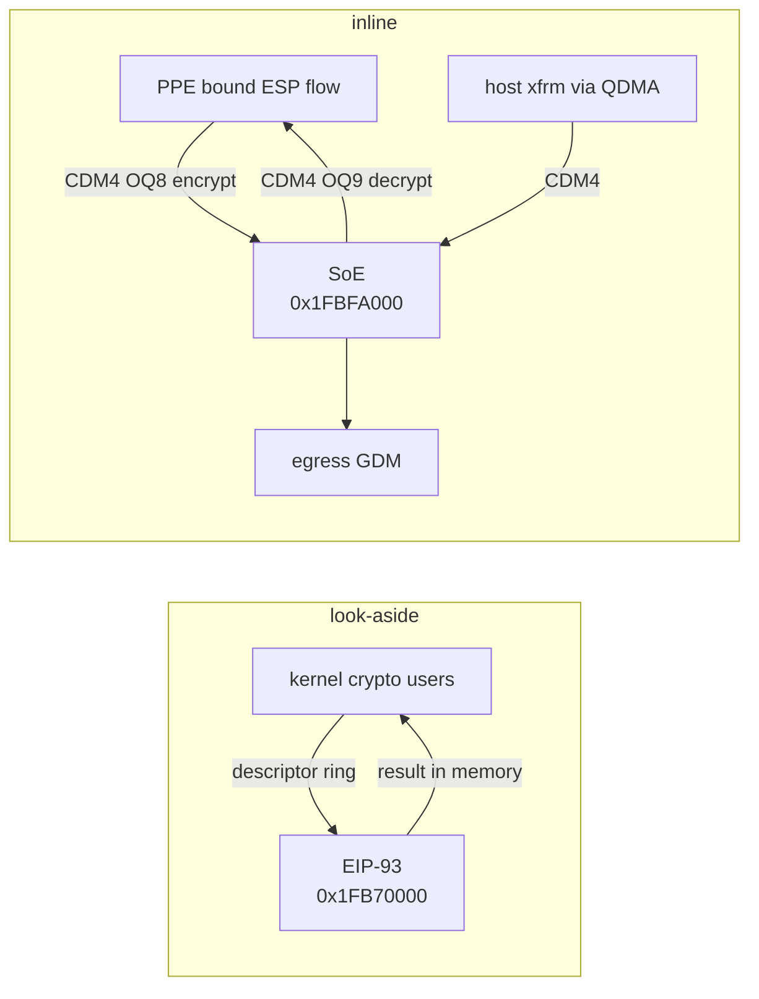

*Figure 18. Look-aside vs inline crypto.*

### 13.1 EIP-93 (look-aside)

The EIP-93 is a packet engine for buffers in memory, hardware revision 3.4.1. It offers:

- ciphers: DES, 3DES, AES (ECB/CBC/CTR);
- hashes and MACs: MD5, SHA-1, SHA-224, SHA-256, HMAC;
- protocol modes: ESP, SSL/TLS/DTLS, SRTP;
- a PRNG.

It is usable for legacy IPsec suites, storage encryption and hashing, and it interrupts on SPI 44.

### 13.2 SoE (inline IPsec)

The SoE sits behind frame-engine port CDM4 on output queues 8 (encrypt) and 9 (decrypt). It processes whole
ESP packets as they cross the frame engine:

| capability | detail |
|---|---|
| mode | ESP tunnel, IPv4 and IPv6 inner and outer |
| ciphers | AES-CBC 128/192/256 with HMAC-SHA1-96, HMAC-SHA256-128 or null; AES-GCM with 8/12/16-byte ICV; ChaCha20-Poly1305 present but unverified |
| protocol | ESN, anti-replay window 64-256, NAT-T, byte and sequence lifetimes, DSCP/ECN copy |
| SAs | register space for 64, 32 used in practice (16 encrypt + 16 decrypt) |
| entry points | from the PPE (a bound ESP flow, with FLOW_CFG hashing ESP by SPI) or from the host (a QDMA descriptor with a hop to the SoE) |

Since the PPE can bind ESP flows directly to the SoE, a site-to-site tunnel can be forwarded entirely in
hardware: LAN, PPE, SoE encrypt, WAN. This matches the "packet offload" form of the Linux xfrm API, in which
the device owns both policy and state. Static analysis also shows a standalone mode at registers +0x300 to
+0x3C0, with a key, a nonce, an AAD length, one contiguous buffer and one operation in flight. Its input is
byte-reversed per 16-byte block. It could serve as a look-aside AEAD engine, but it was not tested.

### 13.3 TRNG

The TRNG is described as a 0xC04-byte window at 0x1FAA1000. The registers start at +0x800:

| offset | register | value on the unit |
|---|---|---|
| +0x800 | ready / count | 0x00008001 (sample ready, count 0x80) |
| +0x804 | enable | 0x80000002 (generator on) |
| +0x824 | health-test status | 0x00040000 (startup test done) |

Offsets +0x000 to +0x0FF read 0xDEADBEEF without a timeout. Offsets +0x100 to +0x7FF time out on the bus;
reading through them caused the SoC reset described in §3.2. A driver should only access +0x800 and above.

### 13.4 eFuse and secure boot

eFuse words are read through the secure monitor (§4.3). The boot chain supports signed FIT images and a
secure-world OS, but the test unit does not enforce signature checking for the operating system.

---

## 14. Time and synchronisation

| block | base | function |
|---|---|---|
| ToD generator | 0x1FBE2300, SPI 78 | 48-bit seconds + 32-bit nanoseconds; integer + fractional increment (5ns at 200MHz); frequency adjust; offset step and load; 1PPS output width; source select (inferred: PON or local) |
| switch timestamper | 0x1FB5E000 | IEEE 1588 on the gigabit ports |
| ETH-lane timestamper | 0x1FA09500 | IEEE 1588 on the ETH SerDes MAC |
| PON-lane timestamper | 0x1FA08500 | IEEE 1588 when the PON lane runs Ethernet |

The timestampers support:

- filters by PTP version, transport (L2, IPv4, IPv6) and unicast/multicast;
- a transmit timestamp FIFO for two-step operation;
- one-step timestamp insertion;
- hardware generation of Sync, Follow_Up, Delay_Req, Pdelay_Req and Announce.

The QDMA receive message has a PTP flag. The PON MACs load the ToD at a superframe boundary, with the
ITU-T time-of-day correction, so the gateway can take time from the OLT. 1PPS can be routed to a GPIO.

None of this was exercised on the unit; the driver wasn't finished by the time of this writing.

---

## 15. The host CPU as a network endpoint

When the gateway itself is the endpoint (speed tests, file sharing, a VPN terminated on the CPU), none of the
offload engines handle TCP, and the two A53 cores set the limit:

| traffic terminated on the host | Mbps | host CPU |
|---|---:|---|
| LAN host to SoC (1GbE port) | 941 | — |
| WAN host to SoC | 1,550-1,820 | 1.6-1.7 cores |
| SoC to WAN host | 2,130 | — |
| SoC to Wi-Fi 7 client | 1,048 | — |

*Figure 19. TCP terminated on the host CPU.*

A profile of the receive case:

- **Cache maintenance: 21% of CPU time.** DMA is not coherent (§4.1), so every receive buffer is
  invalidated.
- **One receive queue.** All of it is processed on CPU 0.
- **Hardware LRO unavailable.** The QDMA LRO contexts (§6.3) are configured per QDMA, and the Ethernet WAN
  port shares QDMA0 with the switch and the 2.5G LAN port, so the driver refuses LRO on it. Receive relies on
  GRO in software instead. The 16KiB aggregate buffers would hold about 11 full-size segments each; at 10Gbps
  that is about 75,000 aggregates per second instead of about 830,000 packets per second.

Transmit is cheaper, since TSO lets one descriptor carry up to 64KiB. A stock PPP layer does not inherit TSO
and checksum offload from the Ethernet device below it, so TCP over a PPPoE WAN would fall back to software
segmentation and checksums. The PPP layer used in this project passes those features through for a
single-channel PPPoE session, and the frame engine then segments and checksums TCP inside the PPPoE header.
Sending over PPPoE costs about half the CPU per bit with that in place.

The chip has two further paths for high-rate self-generated traffic, both requiring driver support:

- **PPE local-out.** Host-sent TSO frames go to the PPE, and a bound entry adds PPPoE and VLAN headers per
  segment after QDMA segmentation.
- **The FE packet generator** of §5.5, for UDP tests.

---

## 16. Other peripherals

| block | base | notes |
|---|---|---|
| UART 1 | 0x1FBF0000, SPI 18 | 16550-compatible, 1.8432MHz reference; boot console |
| UART 2 / 4 / 5 | 0x1FBF0300 / 0600 / 0700, SPI 32 / 61 / 62 | 7.3728MHz reference |
| high-speed UART 3 | 0x1FBE1000, SPI 54 | |
| NPU UART | via pin mux | the NPU's own console |
| I2C 0 / 1 | 0x1FBF8000 / 0x1FBF8100 | 100kHz default; optics and power monitor on bus 0 of the test unit; an I2C-slave SRAM also exists (0x1FBE3000) |
| watchdog and timers | 0x1FBF0100 | |
| SPI-NAND | 0x1FA10000 | on-die ECC NAND, bad-block table in software |
| eMMC | 0x1FA0E000, SPI 170 | |
| USB | xHCI 0x1FAB0000 (SPI 33), PHY 0x1FAC0000 | one USB 3 port (on the QPHY-USB lane) and two USB 2 ports |
| HSDMA | 0x1FA01800, SPI 63 | general memory-to-memory DMA |
| GDMA | 0x1FB30000 | simple copy engine |
| PCM | 0x1FBD0000, SPI 27 | 2 ports on one DMA; 8/16kHz frame sync; 256kHz-8.192MHz bit clock; 32 slots each way; SLIC control over SPI or in-band serial links; clock from a PCM PLL or the PON recovered clock; no hardware codec or echo canceller (voice DSP runs on the A53) |
| power monitor | dying-gasp input, SPI 34 | lets the PON MAC send a dying-gasp message when input power fails |

---

## 17. Open questions

1. **CPU count.** The boot firmware describes four A53 cores, but only two come online. Are cores 2-3 fused
   off, or not present at all?
2. **Undocumented PPE bits.** GLO_CFG bit 10 and TB_CFG bits 14, 15, 22, 23 and 31 are set on the running
   unit. Their function is unknown.
3. **10G receive on the ETH lane.** Block lock is reached, but the XSI MAC reports a local fault and receives
   nothing. The rate-adaptation stage between PCS and MAC is the suspect.
4. **Leftover blocks.** Is there an unused Wi-Fi offload (WED) block at 0x1FA02000? A read of its revision
   register would answer this. Nothing in the datapath uses it.
5. **SoE standalone mode.** Does it allow look-aside ChaCha20-Poly1305 for VPN protocols that are not ESP?
6. **NPU instruction cache.** No instruction-cache invalidate operation is known, so code cannot be
   replaced on a running hart.
7. **DSCP rewrite enable.** GLO_CFG bit 11 is clear on the unit, yet DSCP is always written. What does the bit
   gate?
8. **PCIe link width.** The radio's main function advertises x2. Can the Gen2 root complex train x2 when the
   second lane is free?

---

## Appendix A: register quick reference

| address | name | notes |
|---|---|---|
| 0x09000000 | GICD | GICv3 distributor |
| 0x1E900000 + 0x306000 | NPU BOOT_TRIGGER | boot on a 0 to 1 edge; no NPU register access until ready |
| 0x1E900000 + 0x306004 | NPU BOOT_CONFIG | latched on the trigger edge |
| 0x1E900000 + 0x30C000 | NPU mailbox status | |
| 0x1E900000 + 0x30C168 | NPU MIB10 | boot block address |
| 0x1E900000 + 0x30D030 | NPU host adaptor status | bit 16+n, write 1 to clear |
| 0x1FA09004 | ETH XSI MAC status | local/remote fault |
| 0x1FA20214 | chip SCU LED mux | LED function vs GPIO |
| 0x1FA75930 | ETH PCS 10GBASE-R status | 0x100D = block lock |
| 0x1FA8E270 bit 8 | PON BEN polarity | |
| 0x1FA8E960 | PON force BEN | test only |
| 0x1FA90038 / 3C | Gen2 RC inbound window | NPU SRAM to radio |
| 0x1FAA1800 | TRNG ready | registers only at +0x800 and above |
| 0x1FAF093C bit 0 | PON LOS polarity | |
| 0x1FB00064 | chip ID | bits 31:16 = 0x10 |
| 0x1FB00070 | WAN_CONF | 7:0 PON lane mode; 24/25 mini-OLT |
| 0x1FB00094 | SSR3 | 14:13 ETH lane mode; 29 QPHY mux |
| 0x1FB0009C | SSTR | 10:9 PON, 12:11 PCIe-G3, 14:13 QPHY lane mux |
| 0x1FB000C8 / CC | MDIO masters 0 / 1 | |
| 0x1FB50000 + 0x500 | GDM1 forward config | per-class destination port |
| 0x1FB50000 + 0x800 | TDMA ring | NPU to PPE descriptors |
| 0x1FB50000 + 0xE00 | PPE GLO_CFG | |
| 0x1FB50000 + 0xE04 | PPE FLOW_CFG | flow types, ESP-by-SPI |
| 0x1FB50000 + 0xE1C | PPE TB_CFG | table geometry, ageing, keep-alive |
| 0x1FB50000 + 0xE28 | PPE BNDR | bind rate |
| 0x1FB50000 + 0xE44 | PPE HASH_SEED | |
| 0x1FB50000 + 0xE50 | PPE TB_HASH_CFG | SRAM/DRAM lookup, hash modes |
| 0x1FB50000 + 0xF1C / F20 | PPE RAM_CTRL / RAM_DATA | SRAM entry access |
| 0x1FB50000 + 0xFE0 | Wi-Fi buffer FIFO | pop with 0x80000000 |
| 0x1FB50000 + 0xFEC | Wi-Fi FIFO reason mask | keep 0x1F |
| 0x1FB50000 + 0x2008 | FORCE_SLOW | |
| 0x1FB50000 + 0x2010 | fragment force ports | |
| 0x1FB50000 + 0x48C / 494 / 498 | FE packet generator | shaper, offsets, payload |
| 0x1FB54000 + 0x10A4..0x10AC, 0x10D4..0x10DC | QDMA0 dynamic congestion thresholds | program before hardware forwarding |
| 0x1FBF0200 | GPIO | +0 direction, +4 data, +0x14 output enable |
| 0x1FC28030 / 34 | Gen3 RC inbound window | NPU SRAM to radio |

## Credits

- Anthropic/Claude
- F.
- M.
